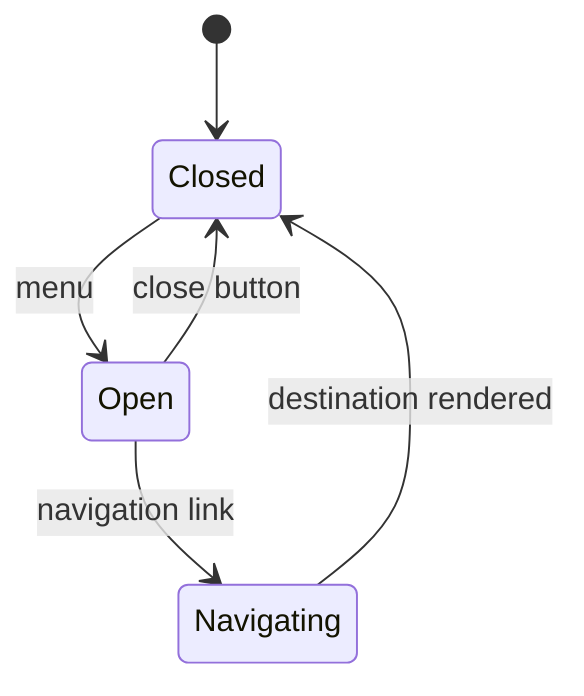
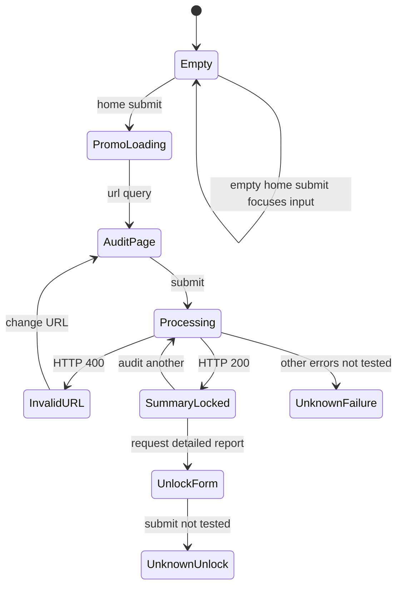

# CLONE_SPEC.md

Especificação de caixa preta de [Psychoactive Studios](https://www.psychoactive.co.nz/), observada em 7 de novembro de 2026. Destino autorizado: `edmundokutuzov333/kutuzovportfolio333`, branch `main`.

## 1. Alcance, método e grau de certeza

Foram inventariadas e carregadas as **52 URLs do sitemap**. REA foi efetivamente executado em GitHub Actions; a inspeção visual e funcional foi complementada por navegador interativo e Playwright remoto. Isto não constitui prova de cobertura de todos os caminhos possíveis, todos os dispositivos ou todos os estados internos.

**OBSERVADO** significa evidência direta nesta execução. **INFERIDO** significa conclusão derivada de sinais, sem inspeção da implementação. **UNKNOWN** identifica o que não foi confirmado. As decisões novas de implementação constam do blueprint e não são atribuídas ao original.

A aquisição limita-se à interface, DOM renderizado, acessibilidade, estilos calculados, URLs de recursos, metadados HTTP e formas JSON. Não foram descarregados bundles para leitura, source maps, shaders, fontes ou recursos gráficos para reutilização. O código e os SVG fornecidos são novos. Os URLs no inventário identificam evidência; não são uma lista de recursos autorizados para incorporar na réplica.

### Registo de evidências

| ID | Evidência e localização verificável |
|---|---|
| E01 | [REA — execução inicial](https://github.com/edmundokutuzov333/kutuzovportfolio333/actions/runs/42326260072), comando `inspect-web-page`, provider `rea-cdp-browser` v2, REA 6.8.0. `evidence_id=ev_182734978867550663a3ee3df3ebedd8e0e0e515f4ac56f7376e787aa27a4bb0`. |
| E02 | [Captura das 52 páginas e tokens](https://github.com/edmundokutuzov333/kutuzovportfolio333/actions/runs/42326588430). [evidence.json](research/psychoactive/evidence.json), campos `sitemap`, `pages` e `tokens`. |
| E03 | [Interações e contratos HTTP](https://github.com/edmundokutuzov333/kutuzovportfolio333/actions/runs/42348274567). [evidence.json](research/psychoactive/evidence.json), `api`, `protocols`, `interactionStates`. Captura final com movimento reduzido. |
| E04 | Observação interativa da home, menu, auditoria e contacto; viewport 614×619, 1440×900 e 390×844. Resumo em `uiObservations` de [evidence.json](research/psychoactive/evidence.json). É um registo de observação, não um ficheiro bruto autenticado pelo REA. |
| E05 | [Sitemap XML](https://www.psychoactive.co.nz/sitemap.xml), HTTP 200, `application/xml`. Lista integral abaixo. |
| E06 | [assets.json](research/psychoactive/assets.json): 416 URLs distintas de imagens presentes no DOM, com texto alternativo e dimensões naturais quando disponíveis. Dimensão zero significa carregamento não confirmado. |
| E07 | [network.json](research/psychoactive/network.json): pedidos e respostas com método, origem, caminho, nomes de parâmetros, status e MIME; valores de parâmetros de CDN não foram conservados. |
| E08 | [Arquitetura do portefólio, snapshot inicial](https://github.com/edmundokutuzov333/kutuzovportfolio333/tree/78cde4a3586ea9c374a023a344d321ea13524fa8). `package.json`, `src/routes`, `src/components`, `src/lib/cms`, `src/lib/public-assets.ts`. |
| E09 | Leitura HTTP anónima do CMS autorizado: [public-config.ts](https://github.com/edmundokutuzov333/kutuzovportfolio333/blob/78cde4a3586ea9c374a023a344d321ea13524fa8/src/lib/cms/public-config.ts), `GET /rest/v1/projects`, `clients`, `pages`, `services`, `page_sections`, `site_settings`: HTTP 200. Contratos no blueprint. |
| E10 | [Verificação da implementação de referência](https://github.com/edmundokutuzov333/kutuzovportfolio333/actions/runs/42395078119): seis testes unitários, compilação e testes de navegador. Não mede igualdade de píxeis com o original. |

REA declarou `attach_limited` e `policy_filtered`; não recuperou eventos anteriores à ligação CDP, origens excluídas nem fontes de scripts. A captura inicial tem cerca de 576 kB de evidência, retida como artefacto de Actions durante sete dias. Os resumos e inventários neste repositório preservam os factos usados. Uma falha inicial de timeout na medição de hover ficou registada; o sucesso de uma execução não elimina essa lacuna.

## 2. Inventário de ecrãs

Todas as linhas seguintes têm evidência E02/E05. A existência e carregamento da rota são OBSERVADOS. O ensaio integral de cada interação em cada instância continua UNKNOWN, salvo indicação explícita nas secções seguintes.

| Rota | Família de ecrã | Contrato visual/funcional |
|---|---|---|
| [`/`](https://www.psychoactive.co.nz/) | Página inicial | Ver requisitos por componente; variantes e estados não exercitados: UNKNOWN. |
| [`/about`](https://www.psychoactive.co.nz/about) | Sobre/equipa/FAQ | Ver requisitos por componente; variantes e estados não exercitados: UNKNOWN. |
| [`/clients`](https://www.psychoactive.co.nz/clients) | Clientes por setor | Ver requisitos por componente; variantes e estados não exercitados: UNKNOWN. |
| [`/contact`](https://www.psychoactive.co.nz/contact) | Contacto orientado | Ver requisitos por componente; variantes e estados não exercitados: UNKNOWN. |
| [`/content-hub`](https://www.psychoactive.co.nz/content-hub) | Índice editorial | Ver requisitos por componente; variantes e estados não exercitados: UNKNOWN. |
| [`/design-audit`](https://www.psychoactive.co.nz/design-audit) | Auditoria | Ver requisitos por componente; variantes e estados não exercitados: UNKNOWN. |
| [`/services`](https://www.psychoactive.co.nz/services) | Índice de serviços | Ver requisitos por componente; variantes e estados não exercitados: UNKNOWN. |
| [`/work`](https://www.psychoactive.co.nz/work) | Índice de portefólio | Ver requisitos por componente; variantes e estados não exercitados: UNKNOWN. |
| [`/content-hub/best-webgl-interactive-3d-agencies`](https://www.psychoactive.co.nz/content-hub/best-webgl-interactive-3d-agencies) | Artigo | Título, corpo estruturado, imagens, partilha e navegação global; variantes e estados não exercitados: UNKNOWN. |
| [`/content-hub/capturing-the-spirit-of-summer-game-fest`](https://www.psychoactive.co.nz/content-hub/capturing-the-spirit-of-summer-game-fest) | Artigo | Título, corpo estruturado, imagens, partilha e navegação global; variantes e estados não exercitados: UNKNOWN. |
| [`/content-hub/from-unity-to-web-gl-building-high-performance-3d-experiences-for-the-modern-web`](https://www.psychoactive.co.nz/content-hub/from-unity-to-web-gl-building-high-performance-3d-experiences-for-the-modern-web) | Artigo | Título, corpo estruturado, imagens, partilha e navegação global; variantes e estados não exercitados: UNKNOWN. |
| [`/content-hub/how-to-write-high-converting-website-content`](https://www.psychoactive.co.nz/content-hub/how-to-write-high-converting-website-content) | Artigo | Título, corpo estruturado, imagens, partilha e navegação global; variantes e estados não exercitados: UNKNOWN. |
| [`/content-hub/how-we-built-award-worthy-websites-for-global-events`](https://www.psychoactive.co.nz/content-hub/how-we-built-award-worthy-websites-for-global-events) | Artigo | Título, corpo estruturado, imagens, partilha e navegação global; variantes e estados não exercitados: UNKNOWN. |
| [`/content-hub/how-we-created-the-sound-for-the-new-psychoactive-website`](https://www.psychoactive.co.nz/content-hub/how-we-created-the-sound-for-the-new-psychoactive-website) | Artigo | Título, corpo estruturado, imagens, partilha e navegação global; variantes e estados não exercitados: UNKNOWN. |
| [`/content-hub/how-we-designed-psychoactive-3`](https://www.psychoactive.co.nz/content-hub/how-we-designed-psychoactive-3) | Artigo | Título, corpo estruturado, imagens, partilha e navegação global; variantes e estados não exercitados: UNKNOWN. |
| [`/content-hub/how-we-designed-the-new-psychoactive-visual-system`](https://www.psychoactive.co.nz/content-hub/how-we-designed-the-new-psychoactive-visual-system) | Artigo | Título, corpo estruturado, imagens, partilha e navegação global; variantes e estados não exercitados: UNKNOWN. |
| [`/content-hub/how-we-designed-the-psychoactive-brand-identity`](https://www.psychoactive.co.nz/content-hub/how-we-designed-the-psychoactive-brand-identity) | Artigo | Título, corpo estruturado, imagens, partilha e navegação global; variantes e estados não exercitados: UNKNOWN. |
| [`/content-hub/how-zendetta-was-made-psychoactives-most-awarded-project`](https://www.psychoactive.co.nz/content-hub/how-zendetta-was-made-psychoactives-most-awarded-project) | Artigo | Título, corpo estruturado, imagens, partilha e navegação global; variantes e estados não exercitados: UNKNOWN. |
| [`/content-hub/mosaic-conversation-cards-online`](https://www.psychoactive.co.nz/content-hub/mosaic-conversation-cards-online) | Artigo | Título, corpo estruturado, imagens, partilha e navegação global; variantes e estados não exercitados: UNKNOWN. |
| [`/content-hub/psychoactive-builds-world-class-gaming-websites`](https://www.psychoactive.co.nz/content-hub/psychoactive-builds-world-class-gaming-websites) | Artigo | Título, corpo estruturado, imagens, partilha e navegação global; variantes e estados não exercitados: UNKNOWN. |
| [`/content-hub/psychoactive-collaborates-with-oasis-for-ethdam`](https://www.psychoactive.co.nz/content-hub/psychoactive-collaborates-with-oasis-for-ethdam) | Artigo | Título, corpo estruturado, imagens, partilha e navegação global; variantes e estados não exercitados: UNKNOWN. |
| [`/content-hub/psychoactive-leads-early-adoption-of-crypto-payroll-in-new-zealand`](https://www.psychoactive.co.nz/content-hub/psychoactive-leads-early-adoption-of-crypto-payroll-in-new-zealand) | Artigo | Título, corpo estruturado, imagens, partilha e navegação global; variantes e estados não exercitados: UNKNOWN. |
| [`/content-hub/psychoactive-named-new-zealands-first-webflow-enterprise-partner`](https://www.psychoactive.co.nz/content-hub/psychoactive-named-new-zealands-first-webflow-enterprise-partner) | Artigo | Título, corpo estruturado, imagens, partilha e navegação global; variantes e estados não exercitados: UNKNOWN. |
| [`/content-hub/psychoactive-nominated-by-awwwards-for-agency-of-the-year-2022`](https://www.psychoactive.co.nz/content-hub/psychoactive-nominated-by-awwwards-for-agency-of-the-year-2022) | Artigo | Título, corpo estruturado, imagens, partilha e navegação global; variantes e estados não exercitados: UNKNOWN. |
| [`/content-hub/psychoactive-officially-recognised-as-a-webflow-professional-partner`](https://www.psychoactive.co.nz/content-hub/psychoactive-officially-recognised-as-a-webflow-professional-partner) | Artigo | Título, corpo estruturado, imagens, partilha e navegação global; variantes e estados não exercitados: UNKNOWN. |
| [`/content-hub/psychoactive-studios-nominated-at-the-wellington-gold-awards`](https://www.psychoactive.co.nz/content-hub/psychoactive-studios-nominated-at-the-wellington-gold-awards) | Artigo | Título, corpo estruturado, imagens, partilha e navegação global; variantes e estados não exercitados: UNKNOWN. |
| [`/content-hub/psychoactive-studios-sponsors-tedxwellington-2024`](https://www.psychoactive.co.nz/content-hub/psychoactive-studios-sponsors-tedxwellington-2024) | Artigo | Título, corpo estruturado, imagens, partilha e navegação global; variantes e estados não exercitados: UNKNOWN. |
| [`/content-hub/webflow-features-explained-what-it-offers-businesses-in-2026`](https://www.psychoactive.co.nz/content-hub/webflow-features-explained-what-it-offers-businesses-in-2026) | Artigo | Título, corpo estruturado, imagens, partilha e navegação global; variantes e estados não exercitados: UNKNOWN. |
| [`/content-hub/what-is-webflow-a-complete-guide-for-business-owners`](https://www.psychoactive.co.nz/content-hub/what-is-webflow-a-complete-guide-for-business-owners) | Artigo | Título, corpo estruturado, imagens, partilha e navegação global; variantes e estados não exercitados: UNKNOWN. |
| [`/content-hub/when-to-build-with-ai-and-when-to-use-webflow-and-custom-code`](https://www.psychoactive.co.nz/content-hub/when-to-build-with-ai-and-when-to-use-webflow-and-custom-code) | Artigo | Título, corpo estruturado, imagens, partilha e navegação global; variantes e estados não exercitados: UNKNOWN. |
| [`/content-hub/why-accessible-healthcare-websites-are-critical-for-patient-trust-and-growth`](https://www.psychoactive.co.nz/content-hub/why-accessible-healthcare-websites-are-critical-for-patient-trust-and-growth) | Artigo | Título, corpo estruturado, imagens, partilha e navegação global; variantes e estados não exercitados: UNKNOWN. |
| [`/content-hub/why-businesses-are-migrating-to-webflow-performance-flexibility-and-scale`](https://www.psychoactive.co.nz/content-hub/why-businesses-are-migrating-to-webflow-performance-flexibility-and-scale) | Artigo | Título, corpo estruturado, imagens, partilha e navegação global; variantes e estados não exercitados: UNKNOWN. |
| [`/content-hub/zendetta-bearing-witness-as-syria-enters-a-new-chapter`](https://www.psychoactive.co.nz/content-hub/zendetta-bearing-witness-as-syria-enters-a-new-chapter) | Artigo | Título, corpo estruturado, imagens, partilha e navegação global; variantes e estados não exercitados: UNKNOWN. |
| [`/industries/events`](https://www.psychoactive.co.nz/industries/events) | Página setorial | Hero, capacidades, trabalhos, prova social, FAQ e CTA; variantes e estados não exercitados: UNKNOWN. |
| [`/industries/gaming`](https://www.psychoactive.co.nz/industries/gaming) | Página setorial | Hero, capacidades, trabalhos, prova social, FAQ e CTA; variantes e estados não exercitados: UNKNOWN. |
| [`/services/build-with-ai`](https://www.psychoactive.co.nz/services/build-with-ai) | Serviço especializado | Hero, capacidades, trabalhos, prova social, FAQ e CTA; variantes e estados não exercitados: UNKNOWN. |
| [`/services/seo-aeo-geo`](https://www.psychoactive.co.nz/services/seo-aeo-geo) | Serviço especializado | Hero, capacidades, trabalhos, prova social, FAQ e CTA; variantes e estados não exercitados: UNKNOWN. |
| [`/services/webflow-enterprise`](https://www.psychoactive.co.nz/services/webflow-enterprise) | Serviço especializado | Hero, capacidades, trabalhos, prova social, FAQ e CTA; variantes e estados não exercitados: UNKNOWN. |
| [`/services/webgl-3d`](https://www.psychoactive.co.nz/services/webgl-3d) | Serviço especializado | Hero, capacidades, trabalhos, prova social, FAQ e CTA; variantes e estados não exercitados: UNKNOWN. |
| [`/work/all-blacks-jersey-launch`](https://www.psychoactive.co.nz/work/all-blacks-jersey-launch) | Caso de estudo | Hero, contexto, narrativa, meios visuais e ligações de projeto; variantes e estados não exercitados: UNKNOWN. |
| [`/work/aratek`](https://www.psychoactive.co.nz/work/aratek) | Caso de estudo | Hero, contexto, narrativa, meios visuais e ligações de projeto; variantes e estados não exercitados: UNKNOWN. |
| [`/work/blackbird`](https://www.psychoactive.co.nz/work/blackbird) | Caso de estudo | Hero, contexto, narrativa, meios visuais e ligações de projeto; variantes e estados não exercitados: UNKNOWN. |
| [`/work/burgerfuel`](https://www.psychoactive.co.nz/work/burgerfuel) | Caso de estudo | Hero, contexto, narrativa, meios visuais e ligações de projeto; variantes e estados não exercitados: UNKNOWN. |
| [`/work/good-shepherd-entertainment`](https://www.psychoactive.co.nz/work/good-shepherd-entertainment) | Caso de estudo | Hero, contexto, narrativa, meios visuais e ligações de projeto; variantes e estados não exercitados: UNKNOWN. |
| [`/work/hellboy`](https://www.psychoactive.co.nz/work/hellboy) | Caso de estudo | Hero, contexto, narrativa, meios visuais e ligações de projeto; variantes e estados não exercitados: UNKNOWN. |
| [`/work/summer-game-fest`](https://www.psychoactive.co.nz/work/summer-game-fest) | Caso de estudo | Hero, contexto, narrativa, meios visuais e ligações de projeto; variantes e estados não exercitados: UNKNOWN. |
| [`/work/super-ai`](https://www.psychoactive.co.nz/work/super-ai) | Caso de estudo | Hero, contexto, narrativa, meios visuais e ligações de projeto; variantes e estados não exercitados: UNKNOWN. |
| [`/work/talent-army`](https://www.psychoactive.co.nz/work/talent-army) | Caso de estudo | Hero, contexto, narrativa, meios visuais e ligações de projeto; variantes e estados não exercitados: UNKNOWN. |
| [`/work/things-inc`](https://www.psychoactive.co.nz/work/things-inc) | Caso de estudo | Hero, contexto, narrativa, meios visuais e ligações de projeto; variantes e estados não exercitados: UNKNOWN. |
| [`/work/woolf`](https://www.psychoactive.co.nz/work/woolf) | Caso de estudo | Hero, contexto, narrativa, meios visuais e ligações de projeto; variantes e estados não exercitados: UNKNOWN. |
| [`/work/world-of-wearableart`](https://www.psychoactive.co.nz/work/world-of-wearableart) | Caso de estudo | Hero, contexto, narrativa, meios visuais e ligações de projeto; variantes e estados não exercitados: UNKNOWN. |
| [`/work/zendetta`](https://www.psychoactive.co.nz/work/zendetta) | Caso de estudo | Hero, contexto, narrativa, meios visuais e ligações de projeto; variantes e estados não exercitados: UNKNOWN. |

Não se presume que sitemap e rotas públicas sejam equivalentes. Ligações adicionais, estados por parâmetros e endpoints API podem existir fora dele. As páginas de erro 404/500 do original não foram provocadas: UNKNOWN.

## 3. Requisitos visíveis e evidência

| ID | Requisito de reprodução | Estado / evidência |
|---|---|---|
| G01 | Apresentar uma entrada animada com indicador de carregamento e conteúdo navegável após a entrada. | OBSERVADO: E04, `#loader-logo`; E03 registou overlay que bloqueou cliques num ensaio. Duração, timeout e fallback: UNKNOWN. |
| G02 | Disponibilizar ligação de salto para `#main-content`, identidade com ligação à home e botão global de menu. | OBSERVADO: E01/E04, `#header-navigation-button`. |
| G03 | No computador, usar marca no canto superior esquerdo e controlo circular de menu no lado direito. | OBSERVADO a 1440×900: E04. Coordenadas para todas as resoluções: UNKNOWN. |
| G04 | Em ecrã estreito, apresentar uma barra clara arredondada na zona inferior, com identidade e menu. | OBSERVADO a 614 px: E04. Token móvel 768 px: E02. Todas as condições de orientação: UNKNOWN. |
| G05 | Abrir navegação sobreposta com ligações About, Work, Services, Content, contacto e pré-visualização de vídeo. Mudar `aria-expanded` e nome do botão. | OBSERVADO: E04, `#main-navigation`; foco passou para a primeira ligação. |
| G06 | Fecho por botão disponível. Escape não fechou a sobreposição na sequência interativa observada. | E04. Não generalizar esse resultado a todos os browsers. Focus trap integral: UNKNOWN. |
| G07 | Controlo de som com estado silenciado e convite inicial para ativar áudio. | OBSERVADO: E04, `#header-sound-button`. Persistência após recarregar e níveis de volume: UNKNOWN. |
| H01 | Hero imersivo com identidade, mensagem curta, CTA e vídeo/showreel. | OBSERVADO: E01/E04. Recurso gráfico exato e implementação de WebGL: UNKNOWN. |
| H02 | Reproduzir showreel numa superfície própria; exibir play, duração e controlos de reprodução. | OBSERVADO: E04, `#video-player-modal`, vídeo com controlos; textos 01:07 e 01:16 observados em estados distintos. Duração canónica: UNKNOWN. |
| H03 | Tratar falha de media com mensagem de indisponibilidade. | OBSERVADO: E04, mensagem curta de falha do player após redimensionamento. Causas e política de recuperação: UNKNOWN. |
| H04 | Alternar quatro grupos de público-alvo e apresentar marcadores geográficos/decorativos. | OBSERVADO: E01/E04. Ritmo exato, easing e relação ao scroll: UNKNOWN. |
| W01 | Home com oito trabalhos, imagens, título clicável e descrição curta em maiúsculas. | OBSERVADO: E02, home. Primeira e sexta imagens ocupam largura superior às vizinhas a 1440 px. |
| W02 | Índice Work com 13 casos, CTA intermédio e acesso aos clientes. | OBSERVADO: E02, /work. Não foi observado filtro nesse índice; a sua existência é UNKNOWN. |
| W03 | Cartões precisam de estados normal, hover, foco, imagem ausente e toque. | Normal e ligações OBSERVADOS; transform/easing/duração exatos de hover UNKNOWN, devido ao timeout de medição. Foco/fallback propostos no blueprint. |
| W04 | Casos de estudo apresentam narrativa segmentada, hero, galerias e ligações. | OBSERVADO: E02, 13 rotas. Modelos exatos de cada bloco de media e sequência interativa: UNKNOWN. |
| C01 | Clientes agrupados por sete setores, com identidade visual e grelha. | OBSERVADO: E02, /clients: jogos, eventos/cultura, tecnologia, saúde, educação, negócios e setor público. |
| C02 | Home remete para clientes e inclui destaque de aniversário desde 2018. | OBSERVADO: E01/E04; contador em dias variável. Fórmula, fuso e momento de atualização: UNKNOWN. |
| A01 | Cartão promocional de auditoria aceita URL num campo de texto e mostra cinco categorias com pontuação ilustrativa. | OBSERVADO: E04, `#promo-audit-url`. 42 e 87 foram vistos antes de um relatório real. |
| A02 | Submissão vazia na home foca o campo; texto inválido pode iniciar carregamento e navegar para a auditoria. | OBSERVADO: E04. String de erro para vazio não foi vista: UNKNOWN. |
| A03 | Navegar de home para `/design-audit?url=...`; preservar o valor no campo. | OBSERVADO: E04, `?url=not+a+url`. |
| A04 | Auditar através de `POST /api/audit`, com `url:string` e `fresh:boolean`. | OBSERVADO: E03, 400 e 200. Significado e valores exatos de `fresh`: UNKNOWN. |
| A05 | Desativar campo/botão durante processamento; mostrar três fases e aviso de 30–60 segundos. | OBSERVADO: E03/E04. O aviso não é SLA nem duração determinística. |
| A06 | Exibir pontuação global /100, cinco pontuações /20, síntese, contagens de pontos fortes/problemas/oportunidades e recomeçar. | OBSERVADO: E04: example.com devolveu 8/100, categorias 3,0,4,1,0 e contagens 1,9,0. |
| A07 | Mostrar explicações acessíveis das categorias através de botões de ajuda. | OBSERVADO: E04; papel, texto acessível e aparência de ativação. Abertura/fecho completo por teclado: UNKNOWN. |
| A08 | Disponibilizar copiar ligação e partilhar em X/LinkedIn. | OBSERVADO: E03/E04. Destinos finais, persistência do relatório e falhas da área de transferência: UNKNOWN. Nenhuma publicação efetuada. |
| A09 | Desbloqueio visual pede email obrigatório, nome e empresa opcionais. | OBSERVADO: E04. Endpoint, consentimento efetivo, entrega de email e ecrã desbloqueado: UNKNOWN; não foram submetidos dados pessoais. |
| A10 | Mostrar uma lista de auditorias recentes. | OBSERVADO: E03, `GET /api/audit-recent` com oito itens na resposta. Estado vazio e erro desse pedido: UNKNOWN. |
| F01 | Home com três cartões editoriais; índice editorial com quatro filtros. | OBSERVADO: E02/E03: todos, recursos, anúncios e casos de estudo. |
| F02 | O filtro Resources altera o endereço para `/content-hub?type=resource` e apresenta contagem. | OBSERVADO: E03. Estado durante transição ainda pode conter elementos de outra categoria; estabilização completa e histórico de navegação: UNKNOWN. |
| F03 | Artigos possuem título, estrutura de leitura, meios visuais e partilha. | OBSERVADO: E02. Links de partilha não acionados: UNKNOWN quanto à operação final. |
| S01 | Serviços mostram introdução, quatro princípios e páginas especializadas. | OBSERVADO: E02. A página principal não deve ser confundida com a grelha de serviços do portefólio destino. |
| S02 | Páginas de serviços e setores incluem provas sociais, carrosséis/repetições de testemunhos e perguntas frequentes. | OBSERVADO: E02. Testemunhos não confirmados na home. Pausa, arrasto e temporização do carrossel: UNKNOWN. |
| S03 | Webflow Enterprise expõe controlos de capacidade e razões para contratação; WebGL/3D e páginas setoriais têm FAQ. | OBSERVADO: E02. Exclusividade entre itens abertos e persistência: UNKNOWN. |
| B01 | About inclui história, oito membros de equipa, princípios e FAQ. | OBSERVADO: E02/E03. A pergunta sobre localização foi acionada. Todos os restantes caminhos: UNKNOWN. |
| P01 | Home apresenta premiações por plataforma, tabela e navegação de páginas. | OBSERVADO: E01/E04. Destaques e plataformas Awwwards, W3, Orpetron, CSS Design Awards, Best, Muse e TechBehemoths. |
| P02 | Contagens expostas: 16,6,6,5,5,2,12; destaque global 50+. | OBSERVADO no instante E04. Não transpor estas distinções para o titular do portefólio. Transições de cada tab: UNKNOWN. |
| T01 | Contacto começa numa experiência com personagem/representação visual, texto animado e três opções. | OBSERVADO: E02/E04, `/contact`: iniciar projeto, equipa e contacto. |
| T02 | Iniciar projeto conduz à recolha obrigatória de nome e email, com botão anterior. | OBSERVADO: E04. Não houve submissão. |
| T03 | DOM contém etapas de empresa/cargo, tipo de serviço, orçamento, prazo, data mensal, descrição e disciplinas. | OBSERVADO estrutural: E02. Visibilidade simultânea, ordem de todos os ramos, envio final e erros de servidor: UNKNOWN. |
| R01 | Rodapé com seis ligações principais, CTA de contacto, endereço de email, distinções externas e relógios. | OBSERVADO: E01/E04. Relógios WLG, MELB, SING, CALI; fusos exatos inferíveis, mas não verificados: UNKNOWN. |
| R02 | Ligações externas de prémios e perfil Webflow devem continuar identificáveis e navegáveis. | OBSERVADO: E01/E02, hrefs em E06/E07/DOM. Recursos gráficos não reutilizados. |

## 4. Máquinas de estados

As transições marcadas UNKNOWN são obrigações em aberto e não resultados de teste.

### Navegação global



Abrir, nome acessível e mudança de foco foram observados (G05). Fecho ao navegar é esperado pela estrutura da interface; todos os detalhes de animação e a restauração do foco são UNKNOWN. A referência usa dialog nativo, Escape, retenção de foco e retorno ao botão como decisões novas de acessibilidade.

### Auditoria observada



A pré-visualização 42/100 é uma camada promocional independente. Não se deve representar a submissão como uma operação que devolve sempre 42. O mock do blueprint usa 42 por requisito do utilizador e identifica-o como simulação.

**Entradas observadas:** texto vazio; `not a url`; `example.com`. A home aceita texto e delega validação. O servidor rejeitou o texto malformado com 400. O domínio sem esquema foi normalizado para HTTPS com barra final. ID de auditoria, metadados de cache e estrutura de relatório surgem na resposta. Não se inferiu uma lista fechada de códigos de erro a partir de um único caso.

**Matriz de casos-limite:**

| Caso | Original | Implementação proposta |
|---|---|---|
| Vazio | Foco no campo da home; E04 | Mensagem de validação e zero pedidos |
| Espaços interiores / URL malformado | 400 e erro visível; E03 | Rejeitar antes do mock |
| Domínio sem esquema | Normalização HTTPS; E04 | Acrescentar HTTPS |
| HTTP explícito, IDN, fragmento, query, credenciais | UNKNOWN | URL nativo; manter query, remover fragmento, rejeitar credenciais |
| IP privado, localhost, IPv6, porta personalizada | UNKNOWN | Mock limitado a nomes públicos; backend futuro exige proteção SSRF real |
| Submissão repetida durante processamento | Controlos desativados; E04 | Guard lógico, AbortController e número de pedido |
| Cancelamento, navegação durante pedido | UNKNOWN | Cancelar e ignorar respostas antigas |
| 429, 500, offline, JSON inválido, timeout | UNKNOWN | Estados de erro distintos e possibilidade de tentar novamente |
| Zero resultados recentes | UNKNOWN | Estado vazio sem inventar pontuações |
| Relatório em cache / cache expirado | Campos existem; E03 | TTL, chave e regras UNKNOWN |
| Email malformado, repetido ou serviço de email indisponível | UNKNOWN | Não declarar sucesso sem confirmação de servidor |

### Outros estados

| Componente | Estados mínimos | Evidência e limites |
|---|---|---|
| Media | poster → a carregar → reprodução ↔ pausa → terminado; ramo de falha | Controlos/player/falha OBSERVADOS E04; eventos e recuperação exatos UNKNOWN |
| Cartão | repouso ↔ hover/foco; toque → detalhe | Link e geometria E02; transformação exata UNKNOWN |
| Filtro editorial | todos ↔ categoria → contagem/lista; parâmetros no URL | E03; persistência após reload UNKNOWN |
| FAQ | fechado ↔ aberto | E03; fecho concorrente e regras de exclusividade UNKNOWN |
| Premiações | plataforma + página corrente + anterior/seguinte | E04; desativação nos extremos e wrap UNKNOWN |
| Contacto | introdução → intenção → identidade → restantes etapas → envio → confirmação/erro | Primeiro percurso E04; resto estrutural E02, execução final UNKNOWN |
| Layout | ecrã largo ↔ tablet ↔ estreito; conteúdo em carregamento/erro | Tokens E02 e amostras E04; toda a matriz de combinações UNKNOWN |

## 5. Protocolos, formatos e contrato de rede

A página pública usa HTTPS. CDP registou `h2` e `h3` (E03). Não foi detetado um requisito funcional de WebSocket nas interações ensaiadas; utilização noutros percursos: UNKNOWN. O transporte interno do backend, serviços de IA, prompts, fornecedor e base de dados do original são UNKNOWN.

| Superfície | Método/formato confirmado | Evidência |
|---|---|---|
| Documento e rotas | GET, HTML UTF-8 | E07 |
| Bundle carregado | JavaScript sob `/_nuxt/`; folhas CSS | E07; Nuxt é uma inferência do caminho e dos payloads, sem leitura do bundle |
| Hidratação por rota | GET `/_payload.json` e `/about/_payload.json`, JSON; parâmetro `_b` | E07; schema integral UNKNOWN |
| Tipografia | WOFF2: Roobert Regular/Medium e RoobertMono TRIAL Medium | E07; licença e disponibilidade para réplica UNKNOWN |
| Imagens | SVG, WebP, PNG, AVIF e JPEG | E06/E07 |
| Vídeo | WebM local; playlists HLS `.m3u8` da Mux; segmentos MP4 | E07; DRM/transcodificação e política de bitrate UNKNOWN |
| Som | MPEG audio / MP3; áudio MP4 observado nos streams | E07; mistura, espacialização e volume UNKNOWN |
| Analytics | `/_vercel/insights/script.js` | E02/E07; captura é evidência do recurso, não de toda a política de recolha |
| Sitemap | XML | E05 |
| Auditoria | POST JSON `/api/audit` | E03 |
| Auditorias recentes | GET JSON `/api/audit-recent` | E03 |

Forma **observada** do pedido de auditoria, sem atribuir semântica não observada a `fresh`:

```ts
type AuditRequest = { url: string; fresh: boolean };
type RecentAudits = {
  items: { hostname: string; score: number; createdAt: string }[];
};
type Finding = { text: string; type: string; quote: string | null };
type Category = { score: number; findings: Finding[]; next_action: string };
type AuditSuccess = {
  auditId: string;
  url: string;
  cached: boolean;
  cachedAgeMs: number;
  heroImageUrl: string | null;
  pageTitle: string;
  report: {
    summary: string;
    categories: {
      content_craft: Category;
      credibility_trust: Category;
      value_proposition: Category;
      structural_hierarchy: Category;
      conversion_architecture: Category;
    };
    page_title: string;
    overall_score: number;
    hero_image_url: string | null;
  };
};
type AuditFailure = {
  error: boolean; url: string; statusCode: number;
  statusMessage: string; message: string; data: { code: string };
};
```

Os tipos de imagem foram alargados a `string | null` como contrato proposto; apenas `null` foi capturado no exemplo. Enumeração de `Finding.type`, tipos nulos em todas as restantes variantes e limites máximos de arrays: UNKNOWN. Os nomes das categorias e campos foram capturados, não recuperados de código.

A resposta HTTP já inclui campos de findings e next_action antes de introduzir email. Isto comprova a presença dos campos no JSON observado, sem comprovar autorização, persistência ou funcionamento do desbloqueio. O blueprint não implementa nem contorna o endpoint de desbloqueio do original.

## 6. Definições e persistência

| Elemento | Observação | Estado desconhecido |
|---|---|---|
| localStorage/sessionStorage em perfil novo | Listas de chaves vazias nas capturas de páginas e auditoria, E02/E03 | Não prova ausência em sessões com consentimento, som ou desbloqueio |
| URL da auditoria | Query `url` após submissão da home, E04 | URL canónico de relatório/partilha e ID persistido UNKNOWN |
| Filtro editorial | Query `type=resource`, E03 | Recarregamento, valores aceites e valor inválido UNKNOWN |
| Som | Botão silenciado observado, E04 | Chave, duração e suporte por dispositivo UNKNOWN |
| Cookies, IndexedDB, Cache Storage | Não existe inventário integral persistido deste ensaio | UNKNOWN |
| Cache no backend | Campos `cached` e `cachedAgeMs`, E03 | Tecnologia, chave, TTL, invalidação, partilha entre utilizadores UNKNOWN |
| Leads, email e relatórios | UI de desbloqueio/contacto | Tabelas, retenção, exportação, eliminação e autenticação UNKNOWN |
| Tema, idioma e conta do visitante | Não observados controlos nas páginas analisadas | Não afirmar inexistência; UNKNOWN |

A réplica de referência não guarda email, briefing ou URL introduzido em armazenamento local. O draft vive em React. Dados publicados continuam no Supabase do titular. Persistência de relatórios reais é uma nova decisão de produto e não pode ser deduzida desta análise.

## 7. Design system confirmado

[E02/tokens](research/psychoactive/evidence.json) contém o inventário integral dos valores calculados. Os nomes originais servem apenas para rastreabilidade; o CSS novo tem os seus próprios nomes.

- Fundo: #101012; superfície: #1b1b1b; texto: #ffffff; cinzento: #cfcfd0; cinzento claro: #f5f5f5.
- Azul: #136df4; ciano: #17ffff; erro: #ff3333; pontos: #878788; traço: #c2c2c2.
- Acentos: #0646ff, #cc4f8c, #71cff7, #ff9a9a, #e4393c, #ffe2b7.
- Texto com opacidades 8%, 12%, 18%, 40% e 70%; hairline #ffffff1f.
- Fontes declaradas/calculadas: Roobert e RoobertMono. Pesos 400/500. Não copiadas.
- Espaçamento: 0,4,8,12,16,20,24,32,40,48,56,64,80,96,112,160 px.
- Gutters declarados: 160 px, portrait 48 px, móvel 16 px; limite de layout 1920 px.
- Raios: 2,4,8,12,24,48,999 px e 50%.
- Durações: 0.15,0.2,0.3,0.5,1 s. Curvas declaradas: cubic-bezier(.33,1,.68,1), (.25,.1,.25,1), (.76,0,.24,1).
- Breakpoints declarados: 768,992,1024,1200,1440 px. São tokens observados, não prova de que todas as componentes os usam.
- H1: min(5vw,96px); H2: min(3.3333vw,63.9994px); H3: min(2.9167vw,56.0006px); H4: min(2.5vw,48px); H5: clamp(20px,2.0833vw,39.9994px).
- Display: clamp(48px,4.79vw,91.968px); min(6.25vw,120px); min(8.333vw,159.994px); clamp(128px,12.6vw,241.92px); min(14.583vw,279.994px).
- Body: 16,20,24 px; variante XL min(1.6667vw,32.0006px); rótulos mono 12 e 16 px.
- Leading: .88,1,1.1,1.2,1.3,1.4,1.5. Tracking: -.07,-.06,-.05,-.04,-.02,0,.08,.14,.22 em.

Exemplos de uso efetivamente medidos a 1440 px: título de projeto 24/30 px; título editorial 20/26 px; H1 da auditoria 72/72 px; CTA de auditoria mono 12 px, padding horizontal 22 px, raio 999 px; rodapé padding vertical 60/48 px. A existência de um token não autoriza aplicar o mesmo valor a todos os elementos.

Bibliotecas exatas de animação do original: **UNKNOWN**. URLs Nuxt e media não demonstram GSAP, Framer Motion, Lenis, Lottie ou Three.js. A implementação destino já contém Framer Motion, Lenis e Three.js (E08); a referência reutiliza as duas primeiras. Shaders, transições líquidas e deformação do logótipo continuam UNKNOWN.

## 8. Critérios de aceitação e obrigações em aberto

Para declarar uma réplica de produção, e não apenas esta referência, é necessário fechar os itens seguintes:

| ID | Obrigação | Evidência em falta |
|---|---|---|
| U01 | Igualdade visual de todas as rotas, desktop/tablet/mobile | Screenshots alinhados, fontes autorizadas, assets equivalentes, máscaras de vídeo/relógios e diffs revistos |
| U02 | Identidade das microinterações e WebGL | Trajetórias, curvas, tempos, triggers e fallback de GPU |
| U03 | Auditoria real | Backend próprio, erros 429/5xx, limites, SSRF, custos, timeout, cache e testes com conteúdos reais |
| U04 | Desbloqueio e email | Consentimento, contrato do backend, envio, reenvio, idempotência e estados finais |
| U05 | Contacto e recrutamento completos | Todos os ramos, submissão, anexos, erros e confirmação |
| U06 | Todos os estados de navegação e acessibilidade | Tab/Shift+Tab, Escape, leitor de ecrã, zoom, foco e mudança de rota |
| U07 | Persistência integral | Cookies/IndexedDB/Cache Storage e alterações após consentimento |
| U08 | Biblioteca/versão exata do original | UNKNOWN; desnecessária para uma implementação independente se equivalência comportamental for verificada |
| U09 | Disponibilidade e autorização de recursos | Fontes/logótipos/vídeo próprios e verificação dos recursos antigos do portefólio |
| U10 | SSR/SEO e rotas limpas na versão final | Migrar a referência CSR/hash para os loaders e rotas TanStack Start existentes |
| U11 | Conteúdo editorial, testemunhos e prémios do titular | Contratos CMS adicionais e conteúdo verificado; não usar distinções da referência |
| U12 | Falhas de rede, 404, 500, vazio, offline | Capturas e ensaios específicos; UNKNOWN no original |

Os testes executados validam a implementação de referência, não fecham U01–U12. Nenhuma parte deste documento deve ser lida como certificação de uma réplica completa, idêntica ao píxel ou pronta para produção.
