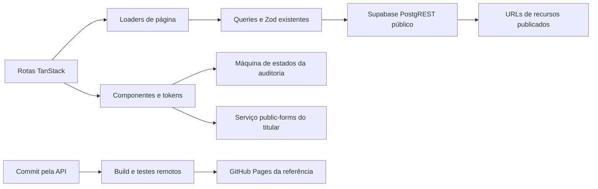
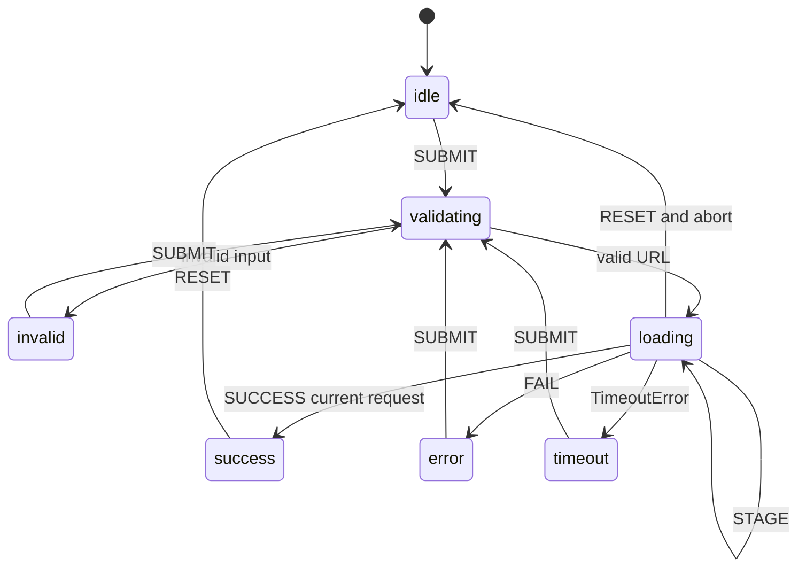

# FULL_REPLICA_SPEC_AND_BLUEPRINT.md

Blueprint de implementação independente, em português de Portugal. Data: 7 de novembro de 2026.

## 1. Resultado entregue e limites

A especificação observacional está em [CLONE_SPEC.md](CLONE_SPEC.md). O código integral dos exemplos está neste documento e em [blueprints/psychoactive](blueprints/psychoactive). Os commits foram criados pela API do GitHub, diretamente em `main`, preservando o histórico.

A referência é uma aplicação executável com conteúdo público do portefólio, componentes originais, auditoria simulada, compilação/testes remotos e publicação GitHub Pages. **Não é uma certificação de réplica integral pronta para produção.** As obrigações U01–U12 da especificação continuam explícitas. A fonte comercial, logótipos, fotografia, vídeos, áudio, animação 3D e textos editoriais do original não foram incorporados.

A referência está separada da aplicação principal porque o pedido define uma especificação para implementação independente. O seu website existente continua na arquitetura TanStack Start. A referência estática permite experimentar os contratos sem trocar a homepage de produção.

## 2. Arquitetura inspirada no repositório existente

Snapshot de análise: [78cde4a](https://github.com/edmundokutuzov333/kutuzovportfolio333/tree/78cde4a3586ea9c374a023a344d321ea13524fa8).

| Camada existente | Papel confirmado | Utilização na referência |
|---|---|---|
| `src/routes/*.tsx` | Rotas TanStack Start, loaders, SEO e componentes por página | Manter a mesma separação de responsabilidade; adaptador SSR completo abaixo |
| `src/components/Shell.tsx` | Navegação, rodapé, Lenis e superfícies globais | Shell original e independente, sem importar o visual do original |
| `src/components/Reveal.tsx` | Framer Motion, reveal em viewport e heading por linhas | `Reveal` novo, com movimento reduzido |
| `src/components/ProjectCard.tsx` | Arte, metadados e ligação por slug | Grelha editorial e imagens via resolver existente |
| `src/lib/cms/loaders.ts` | `loadHomeContent`, `loadContactContent`, `loadClientsContent`, `loadProjectDetailContent` | Reutilização direta |
| `src/lib/cms/queries.ts` | Filtros de publicação, seleção de colunas e parsing | Não duplicar o acesso ao CMS em cada cartão |
| `src/lib/cms/types.ts` | Zod, contratos de página, perfil, projetos, serviços e clientes | Validação existente preservada |
| `src/lib/cms/public-client.ts` | GET PostgREST anónimo; tratamento de erros | Uma origem/chave coerentes; não usar privilégios de servidor |
| `src/lib/public-assets.ts` | URLs absolutas, legado relativo e objetos Storage | Usado por `SafeImage` |
| `src/lib/content.ts` | Conteúdo estático e placeholders do produto | Integrar aí os textos novos na versão final; referência usa o seu módulo `src/lib/content.js` |
| `src/lib/brief.ts`, `src/lib/public-forms.ts` | Contrato de briefing e função `submitContactForm` | Envio real opcional, explícito e apenas no frontend do titular |
| `src/integrations/supabase`, `supabase/functions` | Auth, middleware e serviços de servidor | Não substituir por chamadas privilegiadas no navegador |
| `vite.config.ts` | Configuração TanStack Start/Nitro do projeto | Mantida; a referência tem configuração Vite própria |

Dependências confirmadas no manifesto: React 19, TanStack Router/Start, Tailwind 4, Framer Motion, Lenis, Three.js, Radix, Zod e Supabase JS. Os intervalos e versões resolvidos pelo lockfile podem diferir; o workflow usa `bun install --frozen-lockfile`.

**Bibliotecas do website analisado:** GSAP, Framer Motion, Lenis, Lottie e versões de Three.js são UNKNOWN. O uso das bibliotecas já presentes no destino é uma decisão de implementação. O caminho `/_nuxt/` é evidência da distribuição observada; não obriga a usar Vue/Nuxt numa réplica funcional.



### Estrutura de ficheiros

```text
CLONE_SPEC.md
FULL_REPLICA_SPEC_AND_BLUEPRINT.md
research/psychoactive/
  capture.mjs
  interactions.mjs
  evidence.json
  assets.json
  network.json
blueprints/psychoactive/
  index.html
  vite.config.mjs
  github-api-commit.mjs
  smoke.mjs
  README.md
  src/
    main.jsx
    styles.css
    lib/
      content.js
      audit.mjs
      audit.test.mjs
      cms/loaders.js
    components/
      Shell.jsx
      Primitives.jsx
      Sections.jsx
      AuditCard.jsx
    routes/Pages.jsx
.github/workflows/
  rea-black-box.yml
  replica-reference.yml
```

Os nomes de classes e os templates abaixo são novos. A estrutura não foi copiada do DOM do alvo. JSX produz HTML semântico real; as tags e atributos estão integralmente escritos, sem depender de um gerador de interface.

## 3. Componentes, entradas, saídas e variantes

| Componente | Entrada / saída | Estados e responsabilidade | Requisitos |
|---|---|---|---|
| Shell/Navbar | Perfil e navegação → header, dialog, main e footer | Aberto/fechado, Escape, foco, scroll bloqueado; barra móvel | G02–G07; geometria ajustável, áudio original UNKNOWN |
| Hero | Perfil → nome, headline, função, localização, CTA | Scroll com escala/opacidade, movimento reduzido, modal de demonstração | H01–H04; gráficos originais substituem media não copiados |
| ProjectGrid | Projetos publicados → cartões e links por slug | Primeiro/sexto largos, foco/hover, lazy image e erro de imagem | W01–W04 |
| ClientsGrid | Clientes e logo URL → células de dimensão reservada | Texto quando logo ausente, fallback quando indisponível | C01–C02 |
| AuditCard | URL + cenário → validação, processamento e relatório simulado | Idle/validating/invalid/loading/success/error/timeout; cancelamento | A01–A10 |
| Feed | Conteúdo original → cartões e filtro | Todos/recursos/novidades; índice e detalhe | F01–F03; categorias finais devem vir do CMS |
| Services | Serviços reais → lista expansível e entregáveis | Details/summary, teclado nativo | S01–S03 |
| Testimonials | Itens verificados → citações e autoria | Vazio explícito; scroll-snap se houver conteúdo | S02; não inventa depoimentos |
| Awards | Itens verificados → tabs, tabela e paginação | Seleção, teclado, extremos desativados, vazio explícito | P01–P02 |
| Footer | Perfil → ligações, CTA, email e relógios | Layout fluido; hora via Intl com fusos explícitos | R01–R02; cidades do titular são uma adaptação |
| Contact | Tipos/orçamentos reais → draft e submissão opcional | Quatro etapas, anterior, erro, envio, confirmação por ID | T01–T03; não imita ramos não confirmados |
| Article/Project | Slug + conteúdo → página de detalhe | Encontrado/ausente, media ausente | W04/F03 |
| OriginalMark/BadgePlaceholder | Identificador e rótulo → SVG próprio | IDs estáveis por instância, dimensão reservada, nome acessível | E06; sem copiar marcas |

A regra visual do cartão no código é **proposta**: escala 1.035 e luminosidade 1.05 no hover, easing de 1.2 s; não corresponde a uma medição fechada do original. A documentação não deve apresentar esse efeito como exato.

A biblioteca de placeholders cobre a ocupação do espaço, não a identidade de logótipos. Se o requisito final for igualdade ao píxel, é necessário fornecer recursos próprios/autorizados equivalentes e a tipografia licenciada. A fotografia e a tipografia alteram as quebras de linha e não podem ser substituídas silenciosamente mantendo uma alegação de identidade.

## 4. Design system

Fonte factual: E02, `getComputedStyle(document.documentElement)`. A tabela integral de tokens está no anexo. A origem dos valores é observação, não cópia de ficheiro CSS.

O CSS executável traduz os valores para variáveis próprias. Os tokens declarados não provam utilização uniforme; exemplos concretos de tipografia medidos estão na especificação.

**Tipografia:** Roobert e RoobertMono são observados. A referência usa Arial/Helvetica e Courier New para evitar copiar fontes. Isto é uma substituição deliberada com fidelidade UNKNOWN. Depois de obter licença, substituir apenas `--font-sans` e `--font-mono`, carregar WOFF2 próprios com `font-display:swap` e voltar a medir.

**Composição:** fundo quase preto, texto branco, títulos grandes com tracking negativo, rótulos mono, traços subtis e azul como ação principal. Grelha desktop de duas colunas, com destaques a toda a largura; clientes em células; conteúdo editorial em três colunas. As grelhas da referência são decisões funcionais baseadas nas amostras, não um levantamento de todos os estilos responsivos do original.

**Movimento:** reveal e parallax usam Framer Motion; scroll usa Lenis, já instalado. Não há importação 3D no SSR. Os gráficos inline usam SVG/CSS. O caso `prefers-reduced-motion` elimina transformações temporais decorativas. Durações/curvas ligadas a cada efeito original continuam UNKNOWN.

**Acessibilidade:** headings com ordem lógica, skip link, estados de formulário anunciados, controlo de foco, aria-expanded/selected/pressed, alvos de 44–48 px e alternativa a conteúdo gráfico. Melhorias da referência não são prova de que o original se comporta assim.

## 5. Auditoria: contrato e máquina de estados implementável

O original usa uma home promocional e uma página de relatório. O mock mantém os estados necessários num componente reutilizável; pode ser apresentado completo em `/design-audit`.



O mock HTTP tem os mesmos **nomes e agrupamentos de campos observados** em E03. Os valores e findings são fictícios. `mockAuditResponse` devolve o envelope; `toAuditView` adapta os nomes do servidor à apresentação; `mockAudit` simula espera/cancelamento. O mock de demonstração devolve 42, mas o alvo real devolveu 8 para example.com.

A escolha de tipos de finding, o TTL e as mensagens para falhas além de 400 são PROPOSTA/UNKNOWN. Não é possível afirmar que um schema observado numa resposta cobre todas as variantes do servidor.

O formulário de desbloqueio da referência funciona só no browser: não envia nem conserva o email. A interface diz isso explicitamente. A cópia de ligação transporta apenas o URL para voltar a executar a simulação; não equivale a um relatório persistido.

**Backend real futuro:** substituir a função de mock por um endpoint próprio do titular. Aceitar apenas HTTP(S), resolver DNS no servidor, bloquear destinos internos/loopback/link-local, voltar a validar cada redirect, limitar bytes/tempo/redirects e nunca seguir credenciais embutidas. Não chamar `/api/audit` da Psychoactive a partir do produto final. Estas são decisões de implementação, não capacidades comprovadas do original.

## 6. Supabase: projeto, dados e integração

O módulo público do repositório aponta para **qwjaoheaolpxtciljzvb**. As leituras de projetos, clientes, serviços, páginas e configurações tiveram HTTP 200. O ficheiro `supabase/config.toml` contém **wowmkrzpmebytagimabd**, um identificador diferente. A ligação administrativa disponível não lista o projeto público do portefólio. Por isso, o **DDL implantado integral e as políticas ativas são UNKNOWN**; não se executaram migrações.

Não substituir o projeto público pelo primeiro projeto visível no conector. Não publicar uma chave de servidor. A aplicação existente já fornece uma chave publicável e filtros anónimos; RLS é o limite de acesso. [Documentação Supabase sobre chaves](https://supabase.com/docs/guides/getting-started/api-keys).

### Contratos existentes

| Tabela no schema public | Colunas usadas | Filtro / ordenação | Destino |
|---|---|---|---|
| pages | id,slug,route_path,title,locale,status,seo_title,seo_description,canonical_url,og_image_path | route_path=eq.ROTA; status=eq.published | SEO e identificação da página |
| page_sections | id,page_id,section_key,section_type,position,is_visible,config | page_id=eq.ID; is_visible=eq.true; position.asc | Ordem e configuração dos blocos |
| profile_content | name,role,roles,location,address,public_email,phone,whatsapp,socials,headline,intro,biography,portrait_path | is_published=eq.true | Hero, sobre, contacto e footer |
| projects | id,slug,title,client_label,year_label,discipline,project_type,summary,challenge,idea,outcome,cover_path,cover_alt,gallery,gallery_alt,featured,position,status,hue,locale | status=eq.published; position.asc; featured opcional | Portefólio e detalhe |
| clients | id,slug,name,logo_path,logo_alt,display_as_text,position,is_visible,show_on_home,show_on_clients_page | is_visible=eq.true; contexto home/clients; position.asc | Logos e nomes |
| services | id,slug,title,description,details,number_label,line,position | is_published=eq.true; position.asc | Serviços |
| metrics | id,value,label,note,position | is_published=eq.true; position.asc | Indicadores |
| principles | id,title,description,position | is_published=eq.true; position.asc | Princípios/FAQ editorial |
| experience_items | id,organisation,role,period,description,position | is_published=eq.true; position.asc | Percurso |
| skills | id,name,value,tier,position | is_published=eq.true; position.asc | Competências |
| disciplines | id,name,description,items,position | is_published=eq.true; position.asc | Disciplinas |
| process_steps | id,step_key,title,description,number_label,position | is_published=eq.true; position.asc | Processo |
| site_settings | setting_key,setting_value,is_public | is_public=eq.true; key específica | navigation,footer,presentation,budgets,project_types,contact_steps,capabilities |
| slug_redirects | old_slug,new_slug,is_active | old_slug=eq.SLUG; is_active=eq.true | Redirecionamentos de projeto |
| site_publication_state | singleton_key,published_revision | singleton_key=eq.primary | Revisão publicada |

Fonte: E08, funções `getProjects`, `getClients`, `getServices`, `loadPage` e schemas Zod. Os tipos de dados do PostgreSQL não devem ser confundidos com os tipos serializados JSON. O código reutiliza os schemas existentes para validar o payload.

Exemplo real de leitura, sem chaves embutidas na documentação:

```js
import { SUPABASE_URL, SUPABASE_API_KEY } from "@/lib/cms/public-client";

export async function fetchPublishedProjects(signal) {
  const url = new URL("/rest/v1/projects", SUPABASE_URL);
  url.searchParams.set("select", "id,slug,title,client_label,year_label,discipline,summary,cover_path,cover_alt,gallery,gallery_alt,position");
  url.searchParams.set("status", "eq.published");
  url.searchParams.set("order", "position.asc");
  const response = await fetch(url, {
    method: "GET",
    headers: { apikey: SUPABASE_API_KEY, Accept: "application/json" },
    cache: "no-store",
    signal,
  });
  if (!response.ok) throw new Error("O conteúdo não está disponível: HTTP " + response.status);
  const rows = await response.json();
  if (!Array.isArray(rows)) throw new Error("Resposta inválida do CMS.");
  return rows;
}
```

Usar preferencialmente `getProjects()` já existente, que valida com Zod e tem compatibilidade com a migração de gallery_alt. O código acima demonstra o pedido; não substitui essa validação.

### Recursos do titular

`cover_path` pode ser null: usar `gallery[0]` como o mapper existente já faz. Foram confirmados objetos WebP publicados no bucket **portfolio-public-assets**. Três projetos consultados incluíam `post-4-wash-go`, `01-01` e `01-0111`.

Regras verificadas de `resolvePublicAssetUrl`:

1. URL HTTP(S) absoluta conserva a origem.
2. Caminho `/__l5e/assets-v1/...` resolve para `https://kutuzovportfolio333.lovable.app`, a origem histórica declarada no projeto.
3. Caminho de objeto sem barra inicial resolve para `/storage/v1/object/public/portfolio-public-assets/` com cada segmento codificado.
4. Protocolos não HTTP(S), caminhos de travessia e URLs relativas a protocolo são rejeitados.

A implementação e o deployment não dependem do agente Lovable. **Alguns recursos legados ainda dependem da sua origem de alojamento**: esta dependência factual está no CMS existente. Para a eliminar, migrar apenas recursos do titular para Storage, atualizar logo_path/cover_path/gallery e verificar checksums e MIME. Não adivinhar URLs nem trocar silenciosamente imagens de projetos.

### Conteúdo que falta no CMS examinado

Artigos, prémios e testemunhos não pertencem ao contrato público existente examinado. A ausência física de outras tabelas é UNKNOWN. A referência contém artigos editoriais originais de exemplo e listas vazias de prémios/testemunhos.

O SQL seguinte é uma **extensão proposta**, não o schema descoberto nem uma migração aplicada. Depende da função administrativa existente `public.is_site_admin()`, cuja presença deve ser confirmada no projeto correto antes de executar:

```sql
begin;

create table if not exists public.replica_articles (
  id uuid primary key default gen_random_uuid(),
  slug text not null unique,
  title text not null check (length(title) between 1 and 240),
  category text not null check (category in ('resource', 'announcement', 'case_study')),
  excerpt text not null default '',
  body jsonb not null default '[]'::jsonb check (jsonb_typeof(body) = 'array'),
  cover_path text,
  cover_alt text,
  published_at timestamptz,
  position integer not null default 0 check (position >= 0),
  status text not null default 'draft' check (status in ('draft', 'published', 'archived'))
);

create table if not exists public.replica_testimonials (
  id uuid primary key default gen_random_uuid(),
  author_name text not null,
  company_name text not null,
  quote text not null,
  portrait_path text,
  position integer not null default 0 check (position >= 0),
  is_published boolean not null default false
);

create table if not exists public.replica_awards (
  id uuid primary key default gen_random_uuid(),
  platform text not null,
  prize text not null,
  project_title text not null,
  award_year integer not null check (award_year between 2000 and 2100),
  evidence_url text not null check (evidence_url like 'https://%'),
  position integer not null default 0 check (position >= 0),
  is_published boolean not null default false
);

alter table public.replica_articles enable row level security;
alter table public.replica_testimonials enable row level security;
alter table public.replica_awards enable row level security;

create policy replica_articles_read on public.replica_articles
  for select to anon, authenticated using (status = 'published');
create policy replica_testimonials_read on public.replica_testimonials
  for select to anon, authenticated using (is_published);
create policy replica_awards_read on public.replica_awards
  for select to anon, authenticated using (is_published);

create policy replica_articles_admin on public.replica_articles
  for all to authenticated using (public.is_site_admin()) with check (public.is_site_admin());
create policy replica_testimonials_admin on public.replica_testimonials
  for all to authenticated using (public.is_site_admin()) with check (public.is_site_admin());
create policy replica_awards_admin on public.replica_awards
  for all to authenticated using (public.is_site_admin()) with check (public.is_site_admin());

revoke all on public.replica_articles, public.replica_testimonials, public.replica_awards from anon, authenticated;
grant select on public.replica_articles, public.replica_testimonials, public.replica_awards to anon;
grant select, insert, update, delete on public.replica_articles, public.replica_testimonials, public.replica_awards to authenticated;

commit;
```

Guardar como uma única migração versionada; não repetir fora do gestor de migrações, pois as políticas têm nomes fixos. Não introduzir dados fabricados nem ligar estas tabelas antes de os grants, RLS e o schema serem confirmados.

## 7. Integração final em TanStack Start

A referência executável usa histórico hash para Pages. A versão de produção deve usar as rotas de ficheiro do projeto e manter SSR/SEO, em vez de transportar essa limitação para a homepage.

Exemplo completo da rota de home na integração final, depois de mover os componentes aprovados para `src/components/replica` e os textos para `src/lib/content.ts`:

```tsx
import { createFileRoute } from "@tanstack/react-router";
import { loadHomeContent } from "@/lib/cms/loaders";
import { seoFromPage } from "@/lib/seo";
import { Home } from "@/components/replica/Pages";

export const Route = createFileRoute("/")({
  loader: loadHomeContent,
  head: ({ loaderData }) => loaderData
    ? seoFromPage(loaderData.page)
    : { meta: [{ title: "Edmundo Kutuzov" }] },
  component: HomeRoute,
});

function HomeRoute() {
  return <Home data={Route.useLoaderData()} />;
}
```

Exemplo completo da rota de auditoria com query validada:

```tsx
import { createFileRoute } from "@tanstack/react-router";
import { AuditCard } from "@/components/replica/AuditCard";

export const Route = createFileRoute("/design-audit")({
  validateSearch: (search: Record<string, unknown>) => ({
    url: typeof search.url === "string" && search.url.length <= 2048 ? search.url : "",
  }),
  head: () => ({
    meta: [
      { title: "Auditoria de design — Edmundo Kutuzov" },
      { name: "robots", content: "noindex,nofollow" },
    ],
  }),
  component: AuditRoute,
});

function AuditRoute() {
  const { url } = Route.useSearch();
  return <AuditCard full initialUrl={url} />;
}
```

Estes são adaptadores propostos, não alterações aplicadas às rotas atuais. Na migração, portar JSX para TSX com tipos dos schemas existentes, remover o Shell duplicado da referência e integrar o shell aprovado no `__root.tsx`. Não editar routeTree.gen.ts manualmente: executar o gerador já pertencente ao build.

Não importar Three/Fiber em módulos SSR. Se uma experiência 3D própria for implementada, preservar o padrão ClientOnly/lazy do projeto, estados de GPU indisponível e alternativa estática.

## 8. Recursos gráficos e pipeline visual

O inventário E06 contém 416 URLs de imagens observadas, não 416 ficheiros copiados. Imagens inline, canvas, vídeo, CSS backgrounds e recursos ativados após interação não estão necessariamente todos nesse conjunto: **inventário visual universal UNKNOWN**.

| Família observada | Substituição independente | Geometria / fallback |
|---|---|---|
| Identidade e personagem | OriginalMark SVG novo; identidade do titular | viewBox 400×400, dimensão reservada |
| Hero e fundos | Gradiente CSS e gráfico pontilhado próprio | Altura 100svh, mínimo explícito, redução de movimento |
| Thumbnails dos projetos | URLs do CMS do titular | aspect-ratio definido, object-fit, lazy loading |
| Logos dos clientes | clients.logo_path ou nome em texto | Células reservadas, imagem contain |
| Awwwards/CSS Design Awards e outros badges | BadgePlaceholder original até existir prova/autorização | SVG próprio; rótulo explícito “por confirmar” |
| Showreel e som | Media próprio a fornecer; demonstração SVG no exemplo | Erro/ausência explícitos; nada importado do alvo |
| Imagens de artigos | Arte geométrica original | Relação 1.5 no exemplo |
| Fontes | Fallbacks do sistema ou WOFF2 próprios/licenciados | Revalidar métricas e mudanças de layout |

Passos de preparação: inventariar origem e autorização; verificar tipo real e dimensões; produzir variantes AVIF/WebP; manter original do titular; carregar no bucket público destinado a recursos publicados; escrever URL e alt no CMS; verificar disponibilidade; comparar layout; só então substituir placeholders.

Não converter um badge desconhecido num SVG que simule uma distinção obtida pelo titular. Não copiar o desenho da personagem, tesselações, ilustrações, áudio ou vídeos da referência.

## 9. Automação GitHub e publicação

### Fluxo usado nesta tarefa

1. Ler o HEAD de main e a tree do commit.
2. Criar uma tree com `base_tree_sha` e os novos conteúdos.
3. Criar commit com o HEAD como pai.
4. Atualizar `main` com `expected_sha` e `force:false`.
5. Verificar os jobs de Actions; corrigir apenas com novos commits.

Não foi usada uma cópia Git local, `git push`, rebase ou agente Lovable. O uso de ficheiros de trabalho para elaborar documentação não é uma dependência de execução/deployment.

O script `github-api-commit.mjs` abaixo implementa o mesmo fluxo com REST nativo e aceita um manifesto de ficheiros. A API REST não oferece o mesmo parâmetro `expected_sha` do conector: o script lê de novo o HEAD e usa fast-forward sem força. Se houver corrida depois dessa leitura, o update não-fast-forward é recusado. [Trees](https://docs.github.com/en/rest/git/trees#create-a-tree), [refs](https://docs.github.com/en/rest/git/refs#update-a-reference).

Formato do manifesto:

```json
[
  {
    "path": "README.md",
    "content": "# Implementação independente\n\nDocumentação em português.\n"
  }
]
```

Para o repositório existente, executar num runner autorizado com `REPOSITORY=edmundokutuzov333/kutuzovportfolio333`, `FILES_MANIFEST` e token em secret do runner. O manifesto deve conter apenas os ficheiros pretendidos; a base_tree preserva os restantes.

Para um novo repositório, definir `NEW_REPOSITORY_NAME` e `NEW_REPOSITORY_PRIVATE=true` ou `false`. O script cria-o na conta autenticada, inicializa a branch e aplica o manifesto. É um caminho alternativo documentado; nesta tarefa foi usado o repositório existente, conforme escolha do utilizador. Um repo novo precisa também do package.json, lockfile, configurações e módulos CMS dos quais a referência depende, ou de adaptadores autónomos equivalentes. O nome “kutuzovportfolio333” isolado não basta para inferir esses conteúdos.

### Workflow de validação/publicação

O ficheiro completo está no anexo e já foi aplicado em main. O build instala dependências num runner Ubuntu, corre testes unitários e Playwright, compila com base path do repositório e entrega o artefacto a GitHub Pages. O teste de navegador não submete o formulário real.

O primeiro deploy falhou ao ativar Pages: `Resource not accessible by integration`. A origem de publicação foi depois ativada pela interface autenticada do GitHub e o job de deploy foi repetido com sucesso. Esta alteração de definição foi feita pela web; todos os commits de código/documentação continuam pela API.

GitHub Pages serve esta **referência estática**. Não aloja o servidor TanStack Start nem o backend de auditoria. A aplicação principal permanece independente. Para a versão final SSR, usar o deployment já configurado do projeto e o pipeline Nitro correspondente; domínio, credenciais e promoção dessa versão não foram alterados.

Antes de declarar produção: fechar U01–U12, substituir mock, verificar acessibilidade e métricas, resolver recursos do titular indisponíveis e validar todas as rotas com o conteúdo definitivo. A CI geral existente falha em `assets:verify`; a validação da referência é um resultado distinto e não deve esconder essa falha.

## 10. Código integral

Os blocos seguintes correspondem aos ficheiros entregues. Não contêm o código do website analisado. Alterações de integração futura devem respeitar os contratos e as lacunas documentados acima.


### blueprints/psychoactive/index.html

```html
<!doctype html>
<html lang="pt-PT">
  <head>
    <meta charset="UTF-8" />
    <meta name="viewport" content="width=device-width, initial-scale=1" />
    <meta name="description" content="Implementação de referência com conteúdo do portefólio de Edmundo Kutuzov." />
    <meta name="robots" content="noindex,nofollow" />
    <title>Estudo de interface — Edmundo Kutuzov</title>
  </head>
  <body>
    <div id="root"></div>
    <script type="module" src="/src/main.jsx"></script>
  </body>
</html>
```

### blueprints/psychoactive/vite.config.mjs

```js
import { defineConfig } from "vite";
import react from "@vitejs/plugin-react";
import { fileURLToPath } from "node:url";
const root = fileURLToPath(new URL(".", import.meta.url));
export default defineConfig({
  root,
  base: process.env.REPLICA_BASE_PATH || "/",
  plugins: [react()],
  resolve: { alias: { "@": fileURLToPath(new URL("../../src", import.meta.url)) } },
  build: { outDir: fileURLToPath(new URL("../../dist-replica", import.meta.url)), emptyOutDir: true },
});
```

### blueprints/psychoactive/src/lib/content.js

```js
export const copy = {
  disclaimer: "Estudo de interface. Gráficos originais. Auditoria simulada.",
  brand: "Edmundo Kutuzov",
  menu: "Menu", close: "Fechar", skip: "Saltar para o conteúdo",
  nav: [
    { path: "/", label: "Início" }, { path: "/work", label: "Trabalho" },
    { path: "/about", label: "Sobre" }, { path: "/services", label: "Serviços" },
    { path: "/clients", label: "Clientes" }, { path: "/content-hub", label: "Conteúdos" },
    { path: "/contact", label: "Contacto" },
  ],
  work: "Trabalhos recentes", clients: "Marcas com quem trabalhei",
  services: "Estratégia, desenho e execução", feed: "Do estúdio",
  contact: "Vamos construir o próximo projeto.",
  audit: {
    title: "O que comunica o seu site nos primeiros segundos?",
    intro: "Experimente o fluxo de auditoria. Esta demonstração não analisa páginas reais.",
    label: "Endereço do site", run: "Iniciar auditoria", reset: "Analisar outro site",
    steps: ["A ler a página", "A avaliar cinco categorias", "A preparar os resultados"],
    categories: ["Clareza", "Conversão", "Texto", "Estrutura", "Confiança"],
    details: ["Explique a proposta principal.", "Destaque a próxima ação.", "Use exemplos concretos.", "Organize os títulos.", "Apresente provas verificáveis."],
  },
  articles: [
    { slug: "sistemas-visuais", category: "Recursos", title: "Construir um sistema visual coerente", text: "Um sistema começa por uma decisão clara e por regras que a equipa consegue aplicar." },
    { slug: "processo-criativo", category: "Novidades", title: "Do conceito ao trabalho publicado", text: "Organizar pesquisa, propostas e validação ajuda a manter a intenção ao longo do projeto." },
    { slug: "medir-resultados", category: "Recursos", title: "Ligar decisões visuais a resultados", text: "Defina primeiro o comportamento esperado e escolha depois como o medir." },
  ],
  testimonials: [],
  awards: [],
  assetUnavailable: "Imagem indisponível",
  missingProof: "Não há testemunhos ou prémios verificados no CMS para apresentar.",
  unavailable: "Não foi possível carregar o conteúdo. Tente novamente.",
};
```

### blueprints/psychoactive/src/lib/audit.mjs

```js
export const initialAuditState = { status: "idle", url: "", error: "", result: null, stage: 0 };
export function normalizePublicUrl(input) {
  const value = input.trim();
  if (!value) throw new Error("Introduza o endereço do site.");
  if (value.length > 2048 || /\s/.test(value)) throw new Error("O endereço contém espaços ou é demasiado longo.");
  let url;
  try { url = new URL(/^[a-z][a-z\d+.-]*:/i.test(value) ? value : "https://" + value); }
  catch { throw new Error("Introduza um endereço válido, por exemplo exemplo.pt."); }
  if (!["http:", "https:"].includes(url.protocol) || url.username || url.password) {
    throw new Error("Use um endereço HTTP ou HTTPS sem credenciais.");
  }
  const host = url.hostname.toLowerCase().replace(/\.$/, "");
  if (!host.includes(".") || host.endsWith(".local") || host.endsWith(".localhost") ||
      host.endsWith(".internal") || /^\d+(?:\.\d+){3}$/.test(host) || host.includes(":") ||
      url.port && !["80", "443"].includes(url.port)) {
    throw new Error("Use um domínio público sem uma porta personalizada.");
  }
  url.hash = "";
  return url.href;
}
export function auditReducer(state, event) {
  switch (event.type) {
    case "RESET": return { ...initialAuditState };
    case "VALIDATE": return { ...initialAuditState, status: "validating" };
    case "INVALID": return { ...state, status: "invalid", error: event.error };
    case "START": return { ...initialAuditState, status: "loading", url: event.url };
    case "STAGE": return state.status === "loading" ? { ...state, stage: event.stage } : state;
    case "SUCCESS": return state.status === "loading" ? { ...state, status: "success", result: event.result } : state;
    case "FAIL": return state.status === "loading" ? { ...state, status: event.timeout ? "timeout" : "error", error: event.error } : state;
    default: return state;
  }
}
function delay(ms, signal) {
  return new Promise((resolve, reject) => {
    if (signal.aborted) return reject(new DOMException("Aborted", "AbortError"));
    const cancel = () => { clearTimeout(timer); reject(new DOMException("Aborted", "AbortError")); };
    const timer = setTimeout(() => { signal.removeEventListener("abort", cancel); resolve(); }, ms);
    signal.addEventListener("abort", cancel, { once: true });
  });
}
export async function mockAudit(url, { signal, onStage = () => {}, scenario = "success", delayMs = 600 }) {
  for (let stage = 0; stage < 3; stage++) { onStage(stage); await delay(delayMs, signal); }
  if (scenario === "timeout") throw new DOMException("O serviço excedeu o tempo de espera.", "TimeoutError");
  if (scenario === "error") throw new Error("O serviço está temporariamente indisponível.");
  const response = mockAuditResponse(url);
  return toAuditView(response);
}
export function mockAuditResponse(url) {
  const keys = ["value_proposition", "conversion_architecture", "content_craft", "structural_hierarchy", "credibility_trust"];
  const scores = [9, 8, 7, 10, 8];
  return {
    auditId: "mock-v1", url, cached: false, cachedAgeMs: 0, heroImageUrl: null, pageTitle: "Demonstração",
    report: {
      summary: "Relatório simulado para demonstrar a interface.", overall_score: 42,
      page_title: "Demonstração", hero_image_url: null,
      categories: Object.fromEntries(keys.map((key,index)=>[key,{
        score:scores[index],
        findings:[{text:"Observação de exemplo, sem analisar o endereço.",type:"issue",quote:null}],
        next_action:"Defina uma melhoria concreta e volte a medir.",
      }])),
    },
  };
}
export function toAuditView(response) {
  const mapping = [
    ["clarity","value_proposition"],["conversion","conversion_architecture"],
    ["copy","content_craft"],["structure","structural_hierarchy"],["trust","credibility_trust"],
  ];
  return {
    id: response.auditId, url: response.url, score: response.report.overall_score, maxScore: 100, mock: true,
    categories: mapping.map(([key,source])=>({key,score:response.report.categories[source].score})),
    counts: {wins:0,issues:5,opportunities:0},
  };
}
```

### blueprints/psychoactive/src/lib/audit.test.mjs

```js
import test from "node:test";
import assert from "node:assert/strict";
import { normalizePublicUrl, mockAudit, mockAuditResponse, toAuditView, auditReducer, initialAuditState } from "./audit.mjs";
test("normalizes a public domain and removes fragments", () => {
  assert.equal(normalizePublicUrl(" exemplo.pt/path#section "), "https://exemplo.pt/path");
  assert.equal(normalizePublicUrl("https://exemplo.pt/?a=1"), "https://exemplo.pt/?a=1");
});
test("rejects malformed and local targets", () => {
  for (const input of ["", "not a url", "javascript:alert(1)", "http://127.0.0.1", "http://localhost", "https://u:p@exemplo.pt", "https://exemplo.pt:8888"]) {
    assert.throws(() => normalizePublicUrl(input));
  }
});
test("mock totals equal 42 and all categories fit 20", async () => {
  const controller = new AbortController();
  const result = await mockAudit("https://example.com/", { signal: controller.signal, delayMs: 1 });
  assert.equal(result.categories.reduce((sum, item) => sum + item.score, 0), result.score);
  assert.equal(result.score, 42);
  assert.ok(result.categories.every(item => item.score >= 0 && item.score <= 20));
});
test("cancels an in-flight mock", async () => {
  const controller = new AbortController();
  const pending = mockAudit("https://example.com/", { signal: controller.signal });
  controller.abort();
  await assert.rejects(pending, { name: "AbortError" });
});
test("ignores results after reset", () => {
  const pending = auditReducer(initialAuditState, { type: "START", url: "https://example.com/" });
  const reset = auditReducer(pending, { type: "RESET" });
  assert.equal(auditReducer(reset, { type: "SUCCESS", result: {} }).status, "idle");
});

test("preserves the captured API field names independently from the UI model", () => {
  const raw = mockAuditResponse("https://example.com/");
  assert.deepEqual(Object.keys(raw.report.categories).sort(), [
    "content_craft","conversion_architecture","credibility_trust","structural_hierarchy","value_proposition",
  ]);
  assert.equal(raw.report.overall_score,42);
  assert.equal(raw.heroImageUrl,null);
  assert.equal(toAuditView(raw).categories.length,5);
});
```

### blueprints/psychoactive/src/lib/cms/loaders.js

```js
import { loadHomeContent } from "../../../../../src/lib/cms/loaders";
import { getPublicPresentation } from "../../../../../src/lib/cms/queries";
export async function loadReplicaContent() {
  const [content, presentation] = await Promise.all([loadHomeContent(), getPublicPresentation()]);
  return { ...content, presentation };
}
```

### blueprints/psychoactive/src/components/AuditCard.jsx

```jsx
import { useEffect, useReducer, useRef, useState } from "react";
import { auditReducer, initialAuditState, mockAudit, normalizePublicUrl } from "../lib/audit.mjs";
import { copy } from "../lib/content";
export function AuditCard({ full = false, initialUrl = "" }) {
  const [state, dispatch] = useReducer(auditReducer, initialAuditState);
  const [input, setInput] = useState(initialUrl);
  const [scenario, setScenario] = useState("success");
  const [unlocked, setUnlocked] = useState(false);
  const [shareStatus, setShareStatus] = useState("");
  const current = useRef(null);
  const sequence = useRef(0);
  const resultHeading = useRef(null);
  const busy = ["validating", "loading"].includes(state.status);
  useEffect(() => () => { current.current?.abort(); sequence.current++; }, []);
  useEffect(() => {
    if (state.status === "success") resultHeading.current?.focus();
  }, [state.status]);
  function reset() {
    current.current?.abort(); sequence.current++;
    setUnlocked(false); setShareStatus(""); dispatch({ type: "RESET" });
  }
  async function submit(event) {
    event.preventDefault();
    if (busy) return;
    current.current?.abort();
    const request = ++sequence.current;
    dispatch({ type: "VALIDATE" }); setUnlocked(false); setShareStatus("");
    let url;
    try { url = normalizePublicUrl(input); }
    catch (error) { dispatch({ type: "INVALID", error: error.message }); return; }
    const controller = new AbortController();
    current.current = controller;
    dispatch({ type: "START", url });
    try {
      const result = await mockAudit(url, {
        signal: controller.signal, scenario,
        onStage: stage => dispatch({ type: "STAGE", stage }),
      });
      if (request === sequence.current) dispatch({ type: "SUCCESS", result });
    } catch (error) {
      if (request !== sequence.current || error.name === "AbortError") return;
      dispatch({ type: "FAIL", error: error.message, timeout: error.name === "TimeoutError" });
    }
  }
  async function share() {
    const url = new URL(window.location.href);
    url.hash = "/design-audit?url=" + encodeURIComponent(state.url);
    try { await navigator.clipboard.writeText(url.href); setShareStatus("Ligação copiada."); }
    catch { setShareStatus("Não foi possível copiar automaticamente. Copie o endereço da barra do navegador."); }
  }
  return (
    <section className={"audit section " + (full ? "audit-full" : "")} aria-labelledby="audit-heading" data-state={state.status}>
      <div>
        <p className="eyebrow">Auditoria de design com IA · simulação</p>
        <h2 id="audit-heading">{copy.audit.title}</h2>
        <p className="muted">{copy.audit.intro}</p>
        <form onSubmit={submit} noValidate aria-busy={busy}>
          <label htmlFor="replica-url">{copy.audit.label}</label>
          <div className="input-row">
            <input id="replica-url" type="text" inputMode="url" autoComplete="url" value={input}
              onChange={event => setInput(event.target.value)} placeholder="exemplo.pt"
              disabled={busy} aria-invalid={state.status === "invalid"} aria-describedby="audit-feedback" />
            <button className="pill primary" disabled={busy}>{busy ? "A analisar…" : copy.audit.run} <span aria-hidden>↗</span></button>
          </div>
        </form>
        <label className="demo-scenario">Cenário da demonstração
          <select value={scenario} disabled={busy} onChange={event => setScenario(event.target.value)}>
            <option value="success">Sucesso</option><option value="error">Falha de rede</option><option value="timeout">Tempo excedido</option>
          </select>
        </label>
        <p id="audit-feedback" role={state.error ? "alert" : "status"}>{state.error || shareStatus}</p>
        {busy && <ol className="audit-steps" aria-live="polite">{copy.audit.steps.map((label,index)=>
          <li key={label} aria-current={index===state.stage ? "step" : undefined} className={index<=state.stage ? "active" : ""}>{label}</li>)}</ol>}
        {state.status !== "idle" && <button className="text-button" onClick={reset}>{busy ? "Cancelar" : copy.audit.reset}</button>}
      </div>
      <div className="audit-preview" aria-live="polite">
        <h3 className="eyebrow" ref={resultHeading} tabIndex={-1}>{state.status === "success" ? "Resultado simulado" : "Pré-visualização ilustrativa"}</h3>
        <div className={"score " + (busy ? "processing" : "")}><strong>{state.result?.score ?? 42}</strong><span>/100</span></div>
        <ul className="ratings">{copy.audit.categories.map((label,index)=>
          <li key={label}><span>{label}</span><meter min="0" max="20" value={state.result?.categories[index].score ?? [9,8,7,10,8][index]} />
            <span>{state.result?.categories[index].score ?? [9,8,7,10,8][index]}/20</span></li>)}</ul>
        {state.status === "success" && <>
          <p className="muted">{state.result.counts.wins} pontos fortes · {state.result.counts.issues} problemas · {state.result.counts.opportunities} oportunidades. Valores fictícios.</p>
          <button className="pill" onClick={share}>Copiar ligação</button>
          {!unlocked ? <form className="unlock" onSubmit={event => { event.preventDefault(); setUnlocked(true); }}>
            <h3>Ver o relatório de exemplo</h3>
            <p>Simulação local: o endereço não é enviado nem guardado.</p>
            <label>Email<input type="email" required autoComplete="off" /></label>
            <label>Nome<input type="text" autoComplete="off" /></label>
            <label>Empresa<input type="text" autoComplete="off" /></label>
            <button className="pill">Mostrar exemplo completo</button>
          </form> : <div className="findings">{copy.audit.categories.map((label,index)=>
            <details key={label}><summary>{label}</summary><p>{copy.audit.details[index]}</p><p className="muted">Exemplo editorial, sem análise do URL introduzido.</p></details>)}</div>}
        </>}
      </div>
    </section>
  );
}
```

### blueprints/psychoactive/src/components/Primitives.jsx

```jsx
import { useId, useState } from "react";
import { motion, useReducedMotion } from "framer-motion";
import { resolvePublicAssetUrl } from "../../../../src/lib/public-assets";
import { copy } from "../lib/content";
export function Reveal({ children, className = "" }) {
  const reduced = useReducedMotion();
  return <motion.div className={className} initial={reduced ? false : { opacity: 0, y: 20 }}
    whileInView={{ opacity: 1, y: 0 }} viewport={{ once: true, margin: "0px 0px -5% 0px" }}
    transition={{ duration: .45, ease: [.16, 1, .3, 1] }}>{children}</motion.div>;
}
export function OriginalMark({ className = "", label = "Símbolo geométrico original" }) {
  const id = useId().replace(/:/g, "");
  return <svg className={className} viewBox="0 0 400 400" role="img" aria-labelledby={id}>
    <title id={id}>{label}</title>
    <defs><radialGradient id={id+"-g"}><stop stopColor="#71cff7"/><stop offset="1" stopColor="#136df4"/></radialGradient>
      <pattern id={id+"-p"} width="8" height="8" patternUnits="userSpaceOnUse"><circle cx="4" cy="4" r="1.5" fill="white"/></pattern>
      <mask id={id+"-m"}><rect width="400" height="400" fill={"url(#"+id+"-p)"}/></mask></defs>
    <circle cx="200" cy="200" r="165" fill={"url(#"+id+"-g)"} mask={"url(#"+id+"-m)"}/>
    <ellipse cx="200" cy="200" rx="184" ry="62" fill="none" stroke="currentColor" opacity=".3" transform="rotate(-30 200 200)"/>
    <circle cx="360" cy="110" r="5" fill="currentColor"/>
  </svg>;
}
export function SafeImage({ source, alt = "", className = "", priority = false }) {
  const url = resolvePublicAssetUrl(source);
  const [failed, setFailed] = useState("");
  if (!url || failed === url) return <div className={"asset-placeholder "+className} role="img" aria-label={alt || copy.assetUnavailable}>
    <OriginalMark/><span>{copy.assetUnavailable}</span></div>;
  return setFailed(url)} />;
}
export function BadgePlaceholder({ label }) {
  return <div className="badge-placeholder" role="img" aria-label={label+" — lugar reservado"}>
    <svg viewBox="0 0 64 64" aria-hidden><path d="M32 5 39 22 57 24 43 36 47 54 32 44 17 54 21 36 7 24 25 22Z" fill="none" stroke="currentColor" strokeWidth="2"/></svg>
    <span>{label}</span><small>por confirmar</small>
  </div>;
}
```

### blueprints/psychoactive/src/components/Shell.jsx

```jsx
import { useEffect, useRef, useState } from "react";
import { Link, Outlet, useRouterState } from "@tanstack/react-router";
import Lenis from "lenis";
import { copy } from "../lib/content";
import { OriginalMark } from "./Primitives";
export function Shell({ data }) {
  const dialog = useRef(null);
  const trigger = useRef(null);
  const [open, setOpen] = useState(false);
  const location = useRouterState({ select: state => state.location.pathname });
  useEffect(() => {
    const element = dialog.current;
    if (open && !element.open) element.showModal();
    if (!open && element.open) element.close();
    const previous = document.body.style.overflow;
    if (open) document.body.style.overflow = "hidden";
    return () => { document.body.style.overflow = previous; };
  }, [open]);
  useEffect(() => { setOpen(false); window.scrollTo(0, 0); }, [location]);
  useEffect(() => {
    const preference = window.matchMedia("(prefers-reduced-motion: reduce)");
    if (preference.matches) return;
    const lenis = new Lenis({ autoRaf: true, anchors: true });
    return () => lenis.destroy();
  }, []);
  function close() { setOpen(false); trigger.current?.focus(); }
  const brand = data.profile.name || copy.brand;
  return <>
    <a className="skip" href="#main-content">{copy.skip}</a>
    <header className="site-header">
      <Link to="/" className="brand" aria-label={brand+" — início"}><OriginalMark/><span>{brand}</span></Link>
      <button className="menu-button" ref={trigger} aria-expanded={open} aria-controls="global-menu" onClick={()=>setOpen(true)}>
        <span>{copy.menu}</span><span aria-hidden>⠿</span>
      </button>
    </header>
    <dialog id="global-menu" className="menu-dialog" ref={dialog} aria-label="Navegação principal"
      onCancel={close} onClose={()=>setOpen(false)} onClick={event=>{if(event.target===event.currentTarget)close();}}>
      <button className="pill menu-close" onClick={close}>{copy.close} ×</button>
      <nav>{copy.nav.map(item=><Link key={item.path} to={item.path} onClick={close}>{item.label}<span aria-hidden>↗</span></Link>)}</nav>
      <OriginalMark className="menu-art"/>
    </dialog>
    <main id="main-content" tabIndex={-1}><Outlet/></main>
    <Footer profile={data.profile}/>
  </>;
}
function WorldClocks() {
  const [now, setNow] = useState(null);
  useEffect(()=>{setNow(new Date());const id=setInterval(()=>setNow(new Date()),60000);return()=>clearInterval(id);},[]);
  return <div className="clocks">{[["Maputo","Africa/Maputo"],["Lisboa","Europe/Lisbon"],["Londres","Europe/London"]].map(([name,zone])=>
    <span key={zone}>{name} <time>{now ? new Intl.DateTimeFormat("pt-PT",{timeZone:zone,hour:"2-digit",minute:"2-digit"}).format(now) : "—"}</time></span>)}</div>;
}
export function Footer({ profile }) {
  return <footer className="site-footer">
    <nav aria-label="Navegação do rodapé">{copy.nav.slice(1).map(item=><Link key={item.path} to={item.path}>{item.label}</Link>)}</nav>
    <Link className="footer-cta" to="/contact">{copy.contact}<span aria-hidden>↗</span></Link>
    <a href={"mailto:"+profile.email}>{profile.email}</a>
    <div className="footer-bottom"><WorldClocks/><p>{copy.disclaimer}</p></div>
  </footer>;
}
```

### blueprints/psychoactive/src/components/Sections.jsx

```jsx
import { useRef, useState } from "react";
import { Link } from "@tanstack/react-router";
import { motion, useScroll, useTransform, useReducedMotion } from "framer-motion";
import { copy } from "../lib/content";
import { OriginalMark, SafeImage, Reveal, BadgePlaceholder } from "./Primitives";
export function Hero({ profile }) {
  const section = useRef(null);
  const reel = useRef(null);
  const reduced = useReducedMotion();
  const { scrollYProgress } = useScroll({ target: section, offset: ["start start", "end start"] });
  const scale = useTransform(scrollYProgress, [0,1], [1,.8]);
  const opacity = useTransform(scrollYProgress, [0,.9], [1,0]);
  return <section className="hero" ref={section}>
    <motion.div className="hero-art" style={reduced ? {} : { scale, opacity }}><OriginalMark/></motion.div>
    <div className="hero-copy"><p className="eyebrow">{profile.roles.join(" · ")}</p><h1>{profile.name}</h1><p>{profile.headline}</p>
      <div className="actions"><Link className="pill primary" to="/contact">Iniciar um projeto ↗</Link>
        <button className="pill" onClick={()=>reel.current.showModal()}>Ver demonstração ▷</button></div></div>
    <p className="hero-location eyebrow">{profile.location}</p>
    <dialog ref={reel} className="reel-dialog" aria-label="Demonstração gráfica original">
      <button className="pill" onClick={()=>reel.current.close()}>Fechar ×</button><OriginalMark className="demo-reel"/>
      <p>Elemento gráfico original. O showreel do estúdio de referência não foi copiado.</p>
    </dialog>
  </section>;
}
export function ProjectGrid({ projects, limit }) {
  const shown = typeof limit === "number" ? projects.slice(0,limit) : projects;
  return <section className="section"><div className="section-heading"><h2>{copy.work}</h2><Link to="/work">Ver todos ↗</Link></div>
    <div className="project-grid">{shown.map((project,index)=><Reveal key={project.id} className={"project-card "+(index===0||index===5 ? "wide" : "")}>
      <Link to="/work/$slug" params={{slug:project.slug}} className="project-link">
        <div className="project-media"><SafeImage source={project.cover} alt={project.coverAlt} priority={index===0}/><span className="project-arrow" aria-hidden>↗</span></div>
        <div className="project-meta"><h3>{project.title}</h3><span>{project.year}</span></div>
        <p className="eyebrow muted">{[project.client,project.discipline].filter(Boolean).join(" · ")}</p>
      </Link></Reveal>)}</div>
    {!shown.length && <p>Nenhum projeto publicado.</p>}
  </section>;
}
export function ClientsGrid({ clients }) {
  return <section className="section"><div className="section-heading"><h2>{copy.clients}</h2><Link to="/clients">Todos os clientes ↗</Link></div>
    <ul className="clients-grid">{clients.map(client=><li key={client.slug}>{client.logo
      ? <SafeImage source={client.logo} alt={client.logoAlt || client.name}/>
      : <span>{client.name}</span>}</li>)}</ul></section>;
}
export function Services({ services }) {
  return <section className="section"><h2>{copy.services}</h2><div className="services-list">{services.map(service=>
    <details key={service.slug}><summary><span className="eyebrow">{service.n}</span><span>{service.title}</span><span aria-hidden>+</span></summary>
      <div className="service-details"><p>{service.text}</p><ul>{service.deliverables.map(item=><li key={item}>{item}</li>)}</ul></div>
    </details>)}</div></section>;
}
export function Testimonials({ items = copy.testimonials }) {
  return <section className="section"><h2>Experiências de colaboração</h2>{items.length
    ? <div className="testimonials">{items.map(item=><figure key={item.id}><blockquote>{item.quote}</blockquote><figcaption>{item.author} · {item.company}</figcaption></figure>)}</div>
    : <p className="muted">{copy.missingProof}</p>}</section>;
}
export function Awards({ items = copy.awards }) {
  const platforms = ["Destaques", ...new Set(items.map(item=>item.platform))];
  const [active,setActive] = useState("Destaques");
  const [page,setPage] = useState(0);
  const selected = active==="Destaques" ? items : items.filter(item=>item.platform===active);
  const pages = Math.max(1,Math.ceil(selected.length/6));
  return <section className="section awards"><div><p className="eyebrow">Reconhecimento verificado</p><h2>{items.length ? items.length+"+" : "—"}</h2>
    {!items.length && <BadgePlaceholder label="Prémio"/>}</div><div>
      <div className="tabs" role="tablist" aria-label="Prémios por plataforma">{platforms.map(name=><button key={name} role="tab"
        id={"tab-"+platforms.indexOf(name)} aria-controls="awards-panel" aria-selected={active===name} tabIndex={active===name ? 0 : -1}
        onKeyDown={event=>{if(["ArrowRight","ArrowLeft"].includes(event.key)){event.preventDefault();const offset=event.key==="ArrowRight"?1:-1;const next=(platforms.indexOf(active)+offset+platforms.length)%platforms.length;setActive(platforms[next]);setPage(0);document.getElementById("tab-"+next)?.focus();}}}
        onClick={()=>{setActive(name);setPage(0);}}>{name}</button>)}</div>
      <div role="tabpanel" id="awards-panel" aria-labelledby={"tab-"+platforms.indexOf(active)}>
        {selected.length ? <table><thead><tr><th>Plataforma</th><th>Prémio</th><th>Projeto</th><th>Ano</th></tr></thead>
          <tbody>{selected.slice(page*6,page*6+6).map(item=><tr key={item.id}><td>{item.platform}</td><td>{item.prize}</td><td>{item.project}</td><td>{item.year}</td></tr>)}</tbody></table>
          : <p className="muted">Sem registos verificados.</p>}
      </div>
      <div className="pager"><button disabled={page===0} onClick={()=>setPage(page-1)} aria-label="Prémios anteriores">←</button>
        <span>{String(page+1).padStart(2,"0")} / {String(pages).padStart(2,"0")}</span>
        <button disabled={page+1>=pages} onClick={()=>setPage(page+1)} aria-label="Próximos prémios">→</button></div>
    </div></section>;
}
export function Feed({ filters = false }) {
  const [category,setCategory] = useState("Todos");
  const items = copy.articles.filter(item=>category==="Todos" || item.category===category);
  return <section className="section"><div className="section-heading"><h2>{copy.feed}</h2><Link to="/content-hub">Ver conteúdos ↗</Link></div>
    {filters && <div className="tabs" aria-label="Filtrar conteúdos">{["Todos","Recursos","Novidades"].map(name=>
      <button key={name} aria-pressed={category===name} onClick={()=>setCategory(name)}>{name}</button>)}</div>}
    <div className="feed-grid">{items.map(item=><article key={item.slug}><Link to="/content-hub/$slug" params={{slug:item.slug}}>
      <div className="feed-art"><OriginalMark label="Ilustração geométrica original"/></div><p className="eyebrow">{item.category}</p><h3>{item.title}</h3>
    </Link></article>)}</div></section>;
}
```

### blueprints/psychoactive/src/routes/Pages.jsx

```jsx
import { useState } from "react";
import { Link } from "@tanstack/react-router";
import { Hero, ProjectGrid, ClientsGrid, Services, Testimonials, Awards, Feed } from "../components/Sections";
import { SafeImage } from "../components/Primitives";
import { AuditCard } from "../components/AuditCard";
import { copy } from "../lib/content";
import { emptyBrief } from "../../../../src/lib/brief";
import { submitContactForm } from "../../../../src/lib/public-forms";
export function Home({ data }) {
  return <><Hero profile={data.profile}/><ProjectGrid projects={data.projects} limit={8}/>
    <ClientsGrid clients={data.clients}/><AuditCard/><Feed/><Services services={data.services}/><Testimonials/><Awards/></>;
}
export function About({ data }) {
  return <><section className="section page-intro"><p className="eyebrow">Sobre</p><h1>{data.profile.name}</h1>
    <p className="lead">{data.profile.intro}</p><SafeImage source={data.profile.portraitPath} alt={data.profile.name}/>
    {data.profile.biography && <p>{data.profile.biography}</p>}</section>
    <section className="section"><h2>Princípios</h2>{data.principles.map(item=><details key={item.title}><summary>{item.title}</summary><p>{item.text}</p></details>)}</section></>;
}
export function Project({ project }) {
  if (!project) return <Missing/>;
  return <article><header className="section page-intro"><p className="eyebrow">{project.client} · {project.year}</p><h1>{project.title}</h1><p className="lead">{project.summary}</p></header>
    <SafeImage source={project.cover} alt={project.coverAlt} className="project-hero" priority/>
    <section className="section case-copy">{[["Desafio",project.challenge],["Ideia",project.idea],["Resultado",project.outcome]].filter(([,text])=>text).map(([title,text])=>
      <div key={title}><h2>{title}</h2><p>{text}</p></div>)}</section>
    <div className="section project-gallery">{project.gallery.map((source,index)=><SafeImage key={source+index} source={source} alt={project.galleryAlt[index] || project.title}/>)}</div>
    <div className="section"><Link to="/work">Voltar ao trabalho ↗</Link></div></article>;
}
export function Article({ slug }) {
  const item = copy.articles.find(article=>article.slug===slug);
  if(!item)return <Missing/>;
  return <article className="section page-intro article"><p className="eyebrow">{item.category} · conteúdo de exemplo</p><h1>{item.title}</h1><p className="lead">{item.text}</p><Link to="/content-hub">Voltar aos conteúdos</Link></article>;
}
export function Missing() { return <section className="section page-intro"><h1>Página não encontrada.</h1><Link to="/">Voltar ao início</Link></section>; }
export function Contact({ data }) {
  const [step,setStep] = useState(0);
  const [draft,setDraft] = useState({ ...emptyBrief, additionalTypes:[], channels:[], deliverables:[], files:[] });
  const [status,setStatus] = useState("idle");
  const [error,setError] = useState("");
  const [receipt,setReceipt] = useState(null);
  const [sendReal,setSendReal] = useState(false);
  const update = (key,value)=>setDraft(previous=>({...previous,[key]:value}));
  async function next(event) {
    event.preventDefault();setError("");
    if(step<3){setStep(step+1);return;}
    if(draft.message.trim().length<10){setError("Descreva o projeto com pelo menos 10 caracteres.");return;}
    if(!sendReal){setStatus("demo");return;}
    if(status==="sending")return;
    setStatus("sending");
    const payload = new FormData();
    Object.entries(draft).forEach(([key,value])=>{
      if(key==="files")return;
      payload.set(key,Array.isArray(value)?JSON.stringify(value):String(value));
    });
    try{
      const result = await submitContactForm(payload);
      if(!result.ok || !result.submissionId)throw new Error("Não foi possível confirmar a gravação.");
      setReceipt(result);setStatus("success");
    }catch(failure){setError(failure.message);setStatus("error");}
  }
  if(status==="success")return <section className="section page-intro" role="status"><h1>Pedido guardado.</h1><p>Referência: {receipt.submissionId}</p>
    <p>Estado da notificação: {receipt.notification || "por confirmar"}. Estado da cópia: {receipt.receipt || "por confirmar"}.</p></section>;
  if(status==="demo")return <section className="section page-intro" role="status"><h1>Demonstração concluída.</h1><p>Não foi enviado qualquer pedido.</p><button className="pill" onClick={()=>setStatus("idle")}>Voltar ao formulário</button></section>;
  return <section className="section page-intro contact"><p className="eyebrow">Novo projeto · etapa {step+1}/4</p><h1>Vamos conversar.</h1>
    <form onSubmit={next}>
      {step===0 && <><label>Nome<input value={draft.name} onChange={e=>update("name",e.target.value)} required maxLength={180} autoComplete="name"/></label>
        <label>Email<input type="email" value={draft.email} onChange={e=>update("email",e.target.value)} required autoComplete="email"/></label></>}
      {step===1 && <><label>Empresa<input value={draft.company} onChange={e=>update("company",e.target.value)} maxLength={240}/></label>
        <label>Serviço<select value={draft.type} onChange={e=>update("type",e.target.value)} required><option value="">Escolher</option>{data.projectTypes.map(type=><option key={type}>{type}</option>)}</select></label></>}
      {step===2 && <><label>Orçamento<select value={draft.budget} onChange={e=>update("budget",e.target.value)}>{[...new Set([draft.budget,...Object.values(data.budgets).flat()])].map(value=><option key={value}>{value}</option>)}</select></label>
        <label>Data prevista<input type="date" value={draft.deadline} onChange={e=>update("deadline",e.target.value)}/></label></>}
      {step===3 && <><label>Descrição<textarea value={draft.message} onChange={e=>update("message",e.target.value)} required minLength={10} maxLength={4000}/></label>
        <label className="check-label"><input type="checkbox" checked={sendReal} onChange={e=>setSendReal(e.target.checked)}/>Enviar este pedido para o Supabase do portefólio. Sem esta opção, apenas simular.</label></>}
      {error && <p role="alert">{error}</p>}
      <div className="actions">{step>0 && <button type="button" className="pill" disabled={status==="sending"} onClick={()=>setStep(step-1)}>Anterior</button>}
        <button className="pill primary" disabled={status==="sending"}>{status==="sending"?"A enviar…":step===3?(sendReal?"Enviar pedido":"Concluir simulação"):"Continuar"}</button></div>
    </form></section>;
}
```

### blueprints/psychoactive/src/main.jsx

```jsx
import React from "react";
import { createRoot } from "react-dom/client";
import { createRootRoute, createRoute, createRouter, createHashHistory, RouterProvider } from "@tanstack/react-router";
import { loadReplicaContent } from "./lib/cms/loaders";
import { loadProjectDetailContent, loadContactContent, loadClientsContent } from "../../../src/lib/cms/loaders";
import { Shell } from "./components/Shell";
import { Home, About, Project, Article, Missing, Contact } from "./routes/Pages";
import { ProjectGrid, ClientsGrid, Services, Feed } from "./components/Sections";
import { AuditCard } from "./components/AuditCard";
import "./styles.css";
const rootRoute = createRootRoute({
  loader: loadReplicaContent,
  component: function Root() { return <Shell data={rootRoute.useLoaderData()}/>; },
  pendingComponent: ()=><div className="loading" role="status">A carregar o conteúdo…</div>,
  errorComponent: ({error,reset})=><section className="section page-intro" role="alert"><h1>Conteúdo temporariamente indisponível.</h1><p>{error.message}</p><button className="pill" onClick={reset}>Tentar novamente</button></section>,
  notFoundComponent: Missing,
});
const route = (path,component,extra={}) => createRoute({ getParentRoute:()=>rootRoute, path, component, ...extra });
const home = route("/",()=> <Home data={rootRoute.useLoaderData()}/>);
const work = route("/work",()=> <ProjectGrid projects={rootRoute.useLoaderData().projects}/>);
const about = route("/about",()=> <About data={rootRoute.useLoaderData()}/>);
const services = route("/services",()=> <Services services={rootRoute.useLoaderData().services}/>);
const clients = route("/clients",()=> <ClientsGrid clients={clients.useLoaderData().clients}/>,{loader:loadClientsContent});
const audit = route("/design-audit",()=> <AuditCard full initialUrl={audit.useSearch().url}/>,{validateSearch:search=>({url:typeof search.url==="string"?search.url:""})});
const feed = route("/content-hub",()=> <Feed filters/>);
const article = route("/content-hub/$slug",()=> <Article slug={article.useParams().slug}/>);
const project = route("/work/$slug",()=> <Project project={project.useLoaderData().project}/>,{loader:({params})=>loadProjectDetailContent(params.slug)});
const contact = route("/contact",()=> <Contact data={contact.useLoaderData()}/>,{loader:loadContactContent});
const router = createRouter({routeTree:rootRoute.addChildren([home,work,about,services,clients,audit,feed,article,project,contact]),history:createHashHistory(),defaultPreload:"intent"});
createRoot(document.getElementById("root")).render(<React.StrictMode><RouterProvider router={router}/></React.StrictMode>);
```

### blueprints/psychoactive/src/styles.css

```css
/* Original implementation; measured values are identified in the specification. */
:root {
  color-scheme: dark;
  --background:#101012;--surface:#1b1b1b;--foreground:#fff;--muted:#ffffffb3;
  --line:#ffffff1f;--blue:#136df4;--cyan:#17ffff;--error:#ff3333;
  --font-sans:Arial,Helvetica,sans-serif;--font-mono:"Courier New",monospace;
  --space-1:4px;--space-2:8px;--space-3:12px;--space-4:16px;--space-6:24px;
  --space-8:32px;--space-10:40px;--space-12:48px;--space-16:64px;--space-20:80px;
  --space-24:96px;--space-28:112px;--space-40:160px;
  --gutter:clamp(16px,11.111vw,160px);--radius:12px;--pill:999px;
  --ease:cubic-bezier(.33,1,.68,1);--fast:.15s;--base:.3s;--slow:1s;
}
*{box-sizing:border-box}
html{background:var(--background);scroll-padding-top:100px}
body{margin:0;color:var(--foreground);font:400 16px/1.5 var(--font-sans);overflow-x:clip}
a{color:inherit;text-decoration:none}
a:hover{text-decoration:none}
button,input,select,textarea{font:inherit;color:inherit}
button{cursor:pointer}
button:disabled{cursor:not-allowed;opacity:.4}
button,a,input,textarea,select,summary{-webkit-tap-highlight-color:transparent}
:focus-visible{outline:2px solid var(--cyan);outline-offset:5px}
h1,h2,h3,p{margin:0 0 24px}
h1{font-size:clamp(48px,5vw,96px);line-height:1;letter-spacing:-.05em;font-weight:400}
h2{font-size:clamp(32px,3.3333vw,64px);line-height:1.1;letter-spacing:-.04em;font-weight:400}
h3{font-size:24px;line-height:1.25;font-weight:400}
img{max-width:100%;display:block}
svg{display:block}
.section{padding:80px var(--gutter);max-width:1920px;margin-inline:auto}
.section-heading{display:flex;align-items:baseline;justify-content:space-between;gap:24px;margin-bottom:40px}
.eyebrow,.pill,.menu-button,.tabs,.pager,.clocks{font-family:var(--font-mono);font-size:12px;line-height:1.4;text-transform:uppercase;letter-spacing:.02em}
.muted{color:var(--muted)}
.lead{font-size:clamp(20px,2.5vw,40px);line-height:1.3;max-width:28em}
.actions{display:flex;flex-wrap:wrap;gap:16px;margin-block:24px}
.pill{display:inline-flex;align-items:center;justify-content:center;gap:20px;min-height:48px;padding:12px 24px;border:1px solid var(--line);background:transparent;border-radius:var(--pill);transition:background var(--base) var(--ease),transform var(--base) var(--ease)}
.pill:hover{background:#ffffff14;transform:translateY(-2px)}
.primary{background:var(--blue);border-color:var(--blue)}
.primary:hover{background:#257dff}
.text-button{border:0;border-bottom:1px solid;background:none;padding:6px 0}
.skip{position:fixed;left:16px;top:-100px;padding:16px;background:white;color:black;z-index:9999}
.skip:focus{top:16px}
.site-header{position:fixed;z-index:90;inset:48px 48px auto;display:flex;align-items:center;justify-content:space-between;pointer-events:none}
.site-header>*{pointer-events:auto}
.brand{display:flex;align-items:center;gap:12px;font-size:14px;text-transform:uppercase}
.brand svg{width:44px;height:44px}
.brand span{max-width:180px}
.menu-button{display:flex;align-items:center;gap:12px;background:#f5f5f5;color:#101012;border:0;border-radius:999px;min-height:48px;padding:12px 20px}
.menu-button>span:last-child{font-size:24px;line-height:1}
dialog{color:inherit;border:1px solid var(--line);background:var(--background)}
dialog::backdrop{background:#000c;backdrop-filter:blur(8px)}
.menu-dialog{position:fixed;inset:16px;max-width:none;width:calc(100% - 32px);max-height:calc(100dvh - 32px);height:calc(100dvh - 32px);padding:80px var(--gutter);border-radius:24px;overflow:auto}
.menu-close{position:absolute;right:24px;top:24px}
.menu-dialog nav{position:relative;z-index:1;width:65%;display:grid}
.menu-dialog nav a{font-size:clamp(32px,5vw,72px);line-height:1.1;letter-spacing:-.05em;display:flex;justify-content:space-between;padding:8px 0;border-bottom:1px solid var(--line)}
.menu-dialog nav a:hover{color:var(--cyan)}
.menu-art{position:absolute;width:36vw;right:2vw;bottom:8vh;opacity:.4}
.hero{height:100svh;min-height:620px;position:relative;overflow:hidden;background:radial-gradient(ellipse at 50% 40%,#183044 0%,#101012 60%)}
.hero::after{content:"";position:absolute;inset:0;pointer-events:none;background:repeating-linear-gradient(to bottom,#0002 0,transparent 1.5px,#0002 3px)}
.hero-art{position:absolute;width:min(72vw,900px);left:50%;top:42%;translate:-50% -50%;opacity:.9}
.hero-art svg{width:100%}
.hero-copy{position:absolute;z-index:1;left:var(--gutter);right:var(--gutter);bottom:12%;max-width:850px}
.hero h1{font-size:clamp(56px,8.33vw,160px);line-height:.88;letter-spacing:-.07em}
.hero-copy>p:not(.eyebrow){max-width:32em;font-size:20px}
.hero-location{position:absolute;bottom:24px;right:var(--gutter)}
.reel-dialog{width:min(900px,92vw);border-radius:24px;padding:24px;text-align:center}
.reel-dialog>.pill{float:right}
.demo-reel{height:55vh;width:100%;animation:reel-drift 8s ease-in-out infinite alternate}
@keyframes reel-drift{to{transform:rotate(18deg) scale(.9);filter:hue-rotate(45deg)}}
.project-grid{display:grid;grid-template-columns:repeat(2,minmax(0,1fr));gap:64px 40px}
.project-card.wide{grid-column:1/-1}
.project-media{position:relative;aspect-ratio:1.55;overflow:hidden;border-radius:4px;background:var(--surface)}
.wide .project-media{aspect-ratio:1.9}
.project-media>img,.project-media>.asset-placeholder{width:100%;height:100%;object-fit:cover;transition:transform 1.2s cubic-bezier(.16,1,.3,1),filter .5s var(--ease)}
.project-link:hover .project-media>img,.project-link:focus-visible .project-media>img{transform:scale(1.035);filter:brightness(1.05)}
.project-arrow{position:absolute;right:24px;bottom:24px;display:grid;place-items:center;border-radius:50%;width:48px;height:48px;background:#fff;color:#101012;opacity:0;transform:translateY(12px);transition:opacity var(--base),transform var(--base)}
.project-link:hover .project-arrow,.project-link:focus-visible .project-arrow{opacity:1;transform:none}
.project-meta{display:flex;align-items:baseline;justify-content:space-between;gap:16px;margin-top:20px}
.project-meta h3{margin:0 0 8px}
.project-meta>span{font:12px var(--font-mono);color:var(--muted)}
.asset-placeholder{min-height:160px;display:grid;place-items:center;background:var(--surface);border:1px dashed var(--line);color:var(--muted);font-size:12px;text-align:center;padding:12px}
.asset-placeholder>svg{max-width:160px;max-height:120px}
.clients-grid{list-style:none;margin:0;padding:0;display:grid;grid-template-columns:repeat(4,minmax(0,1fr));border-top:1px solid var(--line);border-left:1px solid var(--line)}
.clients-grid li{min-height:144px;display:grid;place-items:center;padding:24px;border-right:1px solid var(--line);border-bottom:1px solid var(--line)}
.clients-grid img{max-height:72px;max-width:160px;width:100%;object-fit:contain}
.clients-grid .asset-placeholder{min-height:90px;width:100%}
.clients-grid .asset-placeholder svg{display:none}
.audit{display:grid;grid-template-columns:1fr 1fr;gap:80px;background:linear-gradient(140deg,#18242e,#101012 65%)}
.audit h2{font-size:clamp(24px,2.4vw,42px);line-height:1.12;letter-spacing:-.02em;max-width:16em}
.audit-full{padding-top:180px;min-height:80svh}
label{display:block;margin:16px 0;font-size:14px}
input,textarea,select{display:block;width:100%;min-height:44px;border:0;border-bottom:1px solid #ffffff4d;border-radius:0;background:transparent;padding:11px 0;outline-offset:4px}
select{background:var(--background)}
textarea{min-height:160px;resize:vertical}
input[aria-invalid="true"]{border-color:var(--error)}
.input-row{display:flex;align-items:center;gap:18px}
.input-row input{min-width:0}
.input-row button{flex-shrink:0}
.demo-scenario{font-size:12px;color:var(--muted);max-width:240px;margin-top:28px}
.score{display:flex;align-items:baseline;justify-content:center;gap:8px}
.score strong{font-size:clamp(100px,10vw,180px);line-height:1;letter-spacing:-.07em;font-weight:400}
.score>span{color:var(--muted)}
.ratings{list-style:none;margin:32px 0;padding:0}
.ratings li{display:grid;grid-template-columns:90px 1fr 40px;align-items:center;gap:16px;font:12px var(--font-mono);text-transform:uppercase;margin-block:16px}
meter{width:100%;height:8px;border:0}
meter::-webkit-meter-bar{background:#ffffff1f;border:0;border-radius:999px}
meter::-webkit-meter-optimum-value{background:var(--blue)}
.audit-steps{padding-left:24px;color:#ffffff66}
.audit-steps .active{color:#fff}
.processing{animation:pulse 1.2s ease-in-out infinite}
@keyframes pulse{50%{opacity:.35}}
.unlock{margin-top:32px;padding:24px;border:1px solid var(--line);border-radius:12px}
.audit [role="alert"]{color:#ff9a9a}
.findings{margin-top:32px}
details{border-bottom:1px solid var(--line)}
summary{cursor:pointer;padding:24px 0;list-style:none}
summary::-webkit-details-marker{display:none}
summary::after{content:"+";float:right}
details[open]>summary::after{content:"−"}
details p{max-width:60ch}
.services-list summary{display:grid;grid-template-columns:60px 1fr 24px;align-items:center;gap:24px;font-size:clamp(24px,3vw,48px);line-height:1.2}
.services-list summary::after{display:none}
.services-list details[open] summary>span:last-child{transform:rotate(45deg)}
.service-details{display:grid;grid-template-columns:1fr 1fr;gap:40px;padding:0 0 32px 84px;color:var(--muted)}
.testimonials{display:flex;gap:24px;overflow-x:auto;scroll-snap-type:x mandatory}
.testimonials figure{min-width:min(480px,85vw);padding:32px;margin:0;background:var(--surface);scroll-snap-align:start}
.testimonials blockquote{font-size:24px;margin:0 0 32px}
.feed-grid{display:grid;grid-template-columns:repeat(3,minmax(0,1fr));gap:32px}
.feed-art{aspect-ratio:1.5;background:#172230;margin-bottom:24px;overflow:hidden}
.feed-art>svg{height:100%;width:100%;transition:transform .5s var(--ease)}
.feed-grid a:hover svg{transform:scale(1.08)}
.feed-grid h3{font-size:20px;line-height:26px}
.awards{display:grid;grid-template-columns:1fr 2fr;gap:64px}
.awards h2{font-size:clamp(100px,14.583vw,280px);line-height:.8;letter-spacing:-.07em}
.tabs{display:flex;flex-wrap:wrap;gap:8px;margin-bottom:24px}
.tabs button{padding:10px 16px;border:1px solid var(--line);background:none;border-radius:999px;color:var(--muted)}
.tabs button[aria-selected="true"],.tabs button[aria-pressed="true"]{background:white;color:#101012}
table{width:100%;border-collapse:collapse;font-size:14px;text-align:left}
th,td{padding:16px 8px;border-bottom:1px solid var(--line)}
.pager{display:flex;justify-content:flex-end;align-items:center;gap:24px;margin-top:24px}
.pager button{background:none;color:inherit;border:1px solid var(--line);border-radius:50%;width:44px;height:44px}
.badge-placeholder{display:flex;align-items:center;gap:12px;font:12px var(--font-mono);color:var(--muted)}
.badge-placeholder svg{width:40px}
.site-footer{padding:60px var(--gutter) 48px;border-top:1px solid var(--line)}
.site-footer nav{display:flex;flex-wrap:wrap;gap:24px;font:12px var(--font-mono);text-transform:uppercase}
.footer-cta{display:flex;justify-content:space-between;gap:40px;font-size:clamp(36px,5vw,72px);line-height:1.05;letter-spacing:-.05em;margin:80px 0 32px;max-width:1300px}
.footer-bottom{border-top:1px solid var(--line);margin-top:64px;padding-top:24px;display:flex;justify-content:space-between;gap:32px;color:var(--muted)}
.footer-bottom p{font-size:12px;max-width:240px}
.clocks{display:flex;gap:24px;flex-wrap:wrap}
.clocks span{display:grid;gap:8px}
.page-intro{padding-top:180px}
.article{max-width:1200px;min-height:70vh}
.project-hero{width:100%;max-height:80vh;object-fit:contain;background:var(--surface)}
.case-copy>div{display:grid;grid-template-columns:1fr 2fr;gap:64px;padding:48px 0;border-bottom:1px solid var(--line)}
.project-gallery{display:grid;gap:40px}
.project-gallery img{width:100%}
.contact{max-width:1000px;min-height:80vh}
.check-label{display:flex;align-items:flex-start;gap:16px;font-size:14px}
.check-label input{width:22px;min-width:22px;min-height:22px;margin:0}
.loading{min-height:100svh;display:grid;place-items:center}
@media(max-width:1200px){:root{--gutter:48px}.audit{gap:40px}.input-row{align-items:stretch;flex-direction:column}.site-header{inset:24px 32px auto}}
@media(max-width:992px){.clients-grid{grid-template-columns:repeat(3,minmax(0,1fr))}.awards{grid-template-columns:1fr}.menu-dialog nav{width:100%}.menu-art{display:none}}
@media(max-width:768px){
  :root{--gutter:16px}
  .section{padding-block:56px}.section-heading{align-items:flex-start;flex-direction:column;gap:0}
  .site-header{inset:auto 16px max(16px,env(safe-area-inset-bottom));padding:8px 16px;background:#f5f5f5;color:#101012;border-radius:16px}
  .brand svg{height:32px;width:32px}.brand span{max-width:180px;font-size:12px}.menu-button{padding:8px;min-height:32px;background:transparent}
  .menu-dialog{padding:80px 24px 24px}.menu-dialog nav a{font-size:36px}
  .hero{min-height:650px}.hero-copy{bottom:20%}.hero-art{width:120vw;top:35%}.hero-location{bottom:90px}
  .hero h1{font-size:clamp(56px,15vw,88px)}.hero-copy>p:not(.eyebrow){font-size:18px}
  .project-grid{grid-template-columns:1fr;gap:40px}.project-card.wide{grid-column:auto}.wide .project-media,.project-media{aspect-ratio:1.4}
  .project-arrow{opacity:1;transform:none;width:40px;height:40px;right:12px;bottom:12px}
  .project-meta h3{font-size:20px}.clients-grid{grid-template-columns:repeat(2,minmax(0,1fr))}.clients-grid li{min-height:100px;padding:16px}
  .audit{grid-template-columns:1fr;gap:40px}.audit-full,.page-intro{padding-top:80px}.audit h2{font-size:28px}
  .input-row{flex-direction:column}.score strong{font-size:120px}.feed-grid{grid-template-columns:1fr}
  .service-details{grid-template-columns:1fr;padding-left:0;gap:8px}.services-list summary{grid-template-columns:30px 1fr 20px;gap:12px}
  .site-footer{padding-bottom:100px}.footer-cta{margin-top:56px}.footer-bottom{flex-direction:column}
  .case-copy>div{grid-template-columns:1fr;gap:16px}table{font-size:12px}th,td{padding:10px 4px}
}
@media(prefers-reduced-motion:reduce){*,*::before,*::after{animation:none!important;transition:none!important;scroll-behavior:auto!important}}
```

### blueprints/psychoactive/smoke.mjs

```js
import { createRequire } from "node:module";
import { join } from "node:path";
const require = createRequire(join(process.env.TOOL_ROOT, "package.json"));
const { chromium } = require("playwright");
const browser = await chromium.launch({headless:true});
const page = await browser.newPage({viewport:{width:1440,height:900},reducedMotion:"reduce"});
const errors=[];
page.on("pageerror",error=>errors.push(error.message));
try{
  await page.goto("http://127.0.0.1:4178/#/design-audit");
  await page.getByLabel("Endereço do site").fill("bad url");
  await page.getByRole("button",{name:"Iniciar auditoria"}).click();
  await page.getByRole("alert").filter({hasText:"espaços"}).waitFor();
  await page.getByLabel("Endereço do site").fill("example.com");
  await page.getByRole("button",{name:"Iniciar auditoria"}).click();
  await page.locator('[data-state="success"]').waitFor();
  if(await page.locator(".score strong").innerText()!=="42")throw new Error("Unexpected score");
  await page.getByRole("button",{name:"Menu",exact:true}).click();
  await page.getByRole("dialog",{name:"Navegação principal"}).waitFor();
  await page.keyboard.press("Escape");
  await page.getByRole("dialog",{name:"Navegação principal"}).waitFor({state:"hidden"});
  await page.setViewportSize({width:390,height:844});
  const overflow=await page.evaluate(()=>document.documentElement.scrollWidth>innerWidth+1);
  if(overflow)throw new Error("Mobile horizontal overflow");
  if(errors.length)throw new Error(errors.join("\n"));
  console.log(JSON.stringify({auditValidation:true,auditMock42:true,menuEscape:true,mobileOverflow:false,pageErrors:errors}));
}finally{await browser.close();}
```

### .github/workflows/replica-reference.yml

```yaml
name: Replica reference
on:
  push:
    branches: [main]
    paths:
      - 'blueprints/psychoactive/**'
      - '.github/workflows/replica-reference.yml'
  workflow_dispatch:
permissions:
  contents: read
concurrency:
  group: replica-reference
  cancel-in-progress: true
jobs:
  build:
    runs-on: ubuntu-latest
    timeout-minutes: 15
    steps:
      - uses: actions/checkout@v4
      - uses: oven-sh/setup-bun@v2
        with:
          bun-version: '1.4.4'
      - uses: actions/setup-node@v4
        with:
          node-version: '24.22.1'
      - name: Install existing locked dependencies
        run: bun install --frozen-lockfile
      - name: Test audit boundaries
        run: node --test blueprints/psychoactive/src/lib/audit.test.mjs
      - name: Build standalone reference
        run: node node_modules/vite/bin/vite.js build --config blueprints/psychoactive/vite.config.mjs
      - name: Install browser checks
        run: |
          npm install --prefix "$RUNNER_TEMP/replica-tools" --no-audit --no-fund playwright@1.58.2
          "$RUNNER_TEMP/replica-tools/node_modules/.bin/playwright" install --with-deps chromium
      - name: Verify interactions
        env:
          TOOL_ROOT: ${{ runner.temp }}/replica-tools
        run: |
          node node_modules/vite/bin/vite.js preview --config blueprints/psychoactive/vite.config.mjs --host 127.0.0.1 --port 4178 &
          server_pid=$!
          trap 'kill "$server_pid"' EXIT
          for attempt in $(seq 1 30); do
            if curl --silent --fail http://127.0.0.1:4178/ >/dev/null; then break; fi
            sleep 1
          done
          node blueprints/psychoactive/smoke.mjs
      - name: Rebuild with deployment base path
        env:
          REPLICA_BASE_PATH: /${{ github.event.repository.name }}/
        run: node node_modules/vite/bin/vite.js build --config blueprints/psychoactive/vite.config.mjs
      - uses: actions/upload-pages-artifact@v4
        with:
          path: dist-replica
  deploy:
    needs: build
    runs-on: ubuntu-latest
    permissions:
      contents: read
      pages: write
      id-token: write
    environment:
      name: github-pages
      url: ${{ steps.deployment.outputs.page_url }}
    steps:
      - uses: actions/configure-pages@v5
        with:
          enablement: true
      - uses: actions/deploy-pages@v4
        id: deployment
```

### blueprints/psychoactive/github-api-commit.mjs

```js
import { readFile } from "node:fs/promises";
const token = process.env.GITHUB_TOKEN;
if(!token)throw new Error("GITHUB_TOKEN is required");
async function api(method,path,body) {
  const response = await fetch("https://api.github.com"+path,{
    method,
    headers:{Authorization:"Bearer "+token,Accept:"application/vnd.github+json","Content-Type":"application/json","X-GitHub-Api-Version":"2026-03-10"},
    body:body===undefined?undefined:JSON.stringify(body),
  });
  const data=await response.json().catch(()=>null);
  if(!response.ok)throw new Error(method+" "+path+" returned "+response.status+": "+(data?.message||"Unknown error"));
  return data;
}
let repository=process.env.REPOSITORY;
if(process.env.NEW_REPOSITORY_NAME){
  const created=await api("POST","/user/repos",{
    name:process.env.NEW_REPOSITORY_NAME,
    private:process.env.NEW_REPOSITORY_PRIVATE!=="false",
    auto_init:true,
    description:"Implementação original baseada numa especificação de caixa preta",
  });
  repository=created.full_name;
}
if(!repository || !/^[\w.-]+\/[\w.-]+$/.test(repository))throw new Error("Invalid REPOSITORY");
const root="/repos/"+repository;
let ref;
try { ref=await api("GET",root+"/git/ref/heads/main"); }
catch(error){
  if(!process.env.NEW_REPOSITORY_NAME)throw error;
  const repo=await api("GET",root);
  const source=await api("GET",root+"/git/ref/heads/"+encodeURIComponent(repo.default_branch));
  ref=await api("POST",root+"/git/refs",{ref:"refs/heads/main",sha:source.object.sha});
  await api("PATCH",root,{default_branch:"main"});
}
const parent=await api("GET",root+"/git/commits/"+ref.object.sha);
const manifest=JSON.parse(await readFile(process.env.FILES_MANIFEST || "files-manifest.json","utf8"));
if(!Array.isArray(manifest)||!manifest.length)throw new Error("The file manifest must be a non-empty array");
const tree=manifest.map(({path,content})=>{
  if(typeof path!=="string" || path.startsWith("/") || path.split("/").includes("..") || typeof content!=="string")throw new Error("Invalid manifest entry");
  return {path,content,type:"blob",mode:"100644"};
});
const createdTree=await api("POST",root+"/git/trees",{base_tree:parent.tree.sha,tree});
const commit=await api("POST",root+"/git/commits",{message:process.env.COMMIT_MESSAGE||"docs: publish replica specification",tree:createdTree.sha,parents:[parent.sha]});
const fresh=await api("GET",root+"/git/ref/heads/main");
if(fresh.object.sha!==parent.sha)throw new Error("main changed; rebuild the tree from the latest commit");
await api("PATCH",root+"/git/refs/heads/main",{sha:commit.sha,force:false});
console.log(JSON.stringify({repository,commit:commit.sha,url:"https://github.com/"+repository+"/commit/"+commit.sha}));
```

## 11. Anexo: tokens calculados observados

Todos os valores abaixo pertencem a E02; aplicação de cada valor a cada componente continua a exigir medição. Não são uma folha de estilos extraída.

| Token de evidência | Valor calculado/declarado no navegador |
|---|---|
| `--mc-focus` | `1` |
| `--mg-focus` | `1` |
| `--ps-accent-beige` | `#ffe2b7` |
| `--ps-accent-cyan-light` | `#71cff7` |
| `--ps-accent-electric` | `#0646ff` |
| `--ps-accent-magenta` | `#cc4f8c` |
| `--ps-accent-red` | `#e4393c` |
| `--ps-accent-salmon` | `#ff9a9a` |
| `--ps-bp-desktop` | `1440px` |
| `--ps-bp-laptop` | `1200px` |
| `--ps-bp-laptop-small` | `1024px` |
| `--ps-bp-mobile` | `768px` |
| `--ps-bp-tablet` | `992px` |
| `--ps-circle-line-opacity` | `.1` |
| `--ps-circle-line-opacity-portrait` | `.2` |
| `--ps-color-background` | `#101012` |
| `--ps-color-black` | `#000` |
| `--ps-color-blue` | `#136df4` |
| `--ps-color-cyan` | `#17ffff` |
| `--ps-color-dots` | `#878788` |
| `--ps-color-error` | `#f33` |
| `--ps-color-fg-08` | `#ffffff14` |
| `--ps-color-fg-12` | `#ffffff1f` |
| `--ps-color-fg-18` | `#ffffff2e` |
| `--ps-color-fg-40` | `#fff6` |
| `--ps-color-fg-70` | `#ffffffb3` |
| `--ps-color-foreground` | `#fff` |
| `--ps-color-grey` | `#cfcfd0` |
| `--ps-color-grey-light` | `#f5f5f5` |
| `--ps-color-hairline` | `#ffffff1f` |
| `--ps-color-stroke` | `#c2c2c2` |
| `--ps-color-surface` | `#1b1b1b` |
| `--ps-color-white` | `#fff` |
| `--ps-duration-base` | `.2s` |
| `--ps-duration-fast` | `.15s` |
| `--ps-duration-medium` | `.3s` |
| `--ps-duration-slow` | `.5s` |
| `--ps-duration-slower` | `1s` |
| `--ps-ease-in-out` | `cubic-bezier(.76, 0, .24, 1)` |
| `--ps-ease-out-cubic` | `cubic-bezier(.33, 1, .68, 1)` |
| `--ps-ease-standard` | `cubic-bezier(.25, .1, .25, 1)` |
| `--ps-font-body` | `1.25rem` |
| `--ps-font-body-lg` | `1.5rem` |
| `--ps-font-body-sm` | `1rem` |
| `--ps-font-body-xl` | `min(1.6667vw, 32.0006px)` |
| `--ps-font-display-2xl` | `min(8.333vw, 159.994px)` |
| `--ps-font-display-3xl` | `clamp(128px, 12.6vw, 241.92px)` |
| `--ps-font-display-4xl` | `min(14.583vw, 279.994px)` |
| `--ps-font-display-lg` | `clamp(48px, 4.79vw, 91.968px)` |
| `--ps-font-display-xl` | `min(6.25vw, 120px)` |
| `--ps-font-h1` | `min(5vw, 96px)` |
| `--ps-font-h2` | `min(3.3333vw, 63.9994px)` |
| `--ps-font-h3` | `min(2.9167vw, 56.0006px)` |
| `--ps-font-h4` | `min(2.5vw, 48px)` |
| `--ps-font-h5` | `clamp(20px, 2.0833vw, 39.9994px)` |
| `--ps-font-mono` | `"RoobertMono", monospace` |
| `--ps-font-sans` | `"Roobert", sans-serif` |
| `--ps-font-subheader` | `1rem` |
| `--ps-font-subheader-sm` | `.75rem` |
| `--ps-glass-blur` | `22px` |
| `--ps-glass-raised` | `#ffffff12` |
| `--ps-glass-raised-active` | `#ffffff1c` |
| `--ps-glass-raised-shadow` | `0 20px 60px #00000059, inset 0 1px 0 #ffffff14` |
| `--ps-glass-resting` | `#ffffff0d` |
| `--ps-glass-resting-edge` | `inset 0 1px 0 #ffffff0d` |
| `--ps-glass-resting-hover` | `#ffffff14` |
| `--ps-glow-blue` | `0 0 6px #136df4e6` |
| `--ps-gutter` | `160px` |
| `--ps-gutter-mobile` | `16px` |
| `--ps-gutter-portrait` | `48px` |
| `--ps-layout-cap` | `1920px` |
| `--ps-leading-display` | `.88` |
| `--ps-leading-loose` | `1.5` |
| `--ps-leading-none` | `1` |
| `--ps-leading-normal` | `1.3` |
| `--ps-leading-relaxed` | `1.4` |
| `--ps-leading-snug` | `1.2` |
| `--ps-leading-tight` | `1.1` |
| `--ps-radius-button` | `48px` |
| `--ps-radius-full` | `50%` |
| `--ps-radius-lg` | `12px` |
| `--ps-radius-md` | `8px` |
| `--ps-radius-pill` | `999px` |
| `--ps-radius-sm` | `4px` |
| `--ps-radius-xl` | `24px` |
| `--ps-radius-xs` | `2px` |
| `--ps-scan-alpha` | `.13` |
| `--ps-scanlines` | `repeating-linear-gradient(to bottom, rgba(0, 0, 0, .13) 0, transparent 1.5px, rgba(0, 0, 0, .13) 3px)` |
| `--ps-shadow-focus-ring` | `0 0 0 3px #136df424` |
| `--ps-shadow-md` | `0 24px 48px #00000080` |
| `--ps-shadow-sm` | `0 12px 32px #0006` |
| `--ps-space-0` | `0` |
| `--ps-space-1` | `4px` |
| `--ps-space-10` | `40px` |
| `--ps-space-12` | `48px` |
| `--ps-space-14` | `56px` |
| `--ps-space-16` | `64px` |
| `--ps-space-2` | `8px` |
| `--ps-space-20` | `80px` |
| `--ps-space-24` | `96px` |
| `--ps-space-28` | `112px` |
| `--ps-space-3` | `12px` |
| `--ps-space-4` | `16px` |
| `--ps-space-40` | `160px` |
| `--ps-space-5` | `20px` |
| `--ps-space-6` | `24px` |
| `--ps-space-8` | `32px` |
| `--ps-tracking-micro` | `-.02em` |
| `--ps-tracking-normal` | `0` |
| `--ps-tracking-snug` | `-.04em` |
| `--ps-tracking-tight` | `-.05em` |
| `--ps-tracking-tighter` | `-.06em` |
| `--ps-tracking-tightest` | `-.07em` |
| `--ps-tracking-wide` | `.08em` |
| `--ps-tracking-wider` | `.14em` |
| `--ps-tracking-widest` | `.22em` |
| `--ps-transition-base` | `.3s cubic-bezier(.33, 1, .68, 1)` |
| `--ps-weight-medium` | `500` |
| `--ps-weight-regular` | `400` |
| `--ps-z-base` | `0` |
| `--ps-z-below` | `-1` |
| `--ps-z-dropdown` | `10` |
| `--ps-z-header` | `90` |
| `--ps-z-modal` | `100` |
| `--ps-z-nav` | `99` |
| `--ps-z-nav-cover` | `98` |
| `--ps-z-overlay` | `50` |
| `--ps-z-raised` | `1` |
| `--ps-z-skip-link` | `9999` |
| `--ps-z-sticky` | `20` |
| `--ps-z-toast` | `1000` |

## 12. Verificação e cobertura

Build e testes remotos estão associados aos commits e aos runs de Actions, não ao estado de uma máquina local. A evidência de inspeção do original e os resultados de teste da referência são conjuntos diferentes. O relatório final de execução em research/psychoactive/verification.json regista o commit, os testes executados e a publicação. As limitações U01–U12 permanecem abertas mesmo com um pipeline verde.


## 12. Verificação da publicação

Referência publicada: [abrir demonstração](https://edmundokutuzov333.github.io/kutuzovportfolio333/). O commit de código `b23eaa1894c46179e5bb9bd4ab892269c27c48fa` passou seis testes unitários, compilação e verificações Playwright de validação de URL, mock 42/100, Escape no menu e ausência de overflow horizontal móvel. Não ocorreram erros de página nessa bateria. [Execução e publicação bem-sucedidas](https://github.com/edmundokutuzov333/kutuzovportfolio333/actions/runs/42395078119).

A CI geral do portefólio passou typecheck, lint, testes e build, mas falhou na disponibilidade de sete das 256 imagens verificadas em 155 projetos; os testes E2E subsequentes foram omitidos pela própria CI. [Execução com a falha de recursos](https://github.com/edmundokutuzov333/kutuzovportfolio333/actions/runs/42395078028). Este resultado não equivale a uma certificação de réplica integral. Registo estruturado: [verification.json](research/psychoactive/verification.json).
