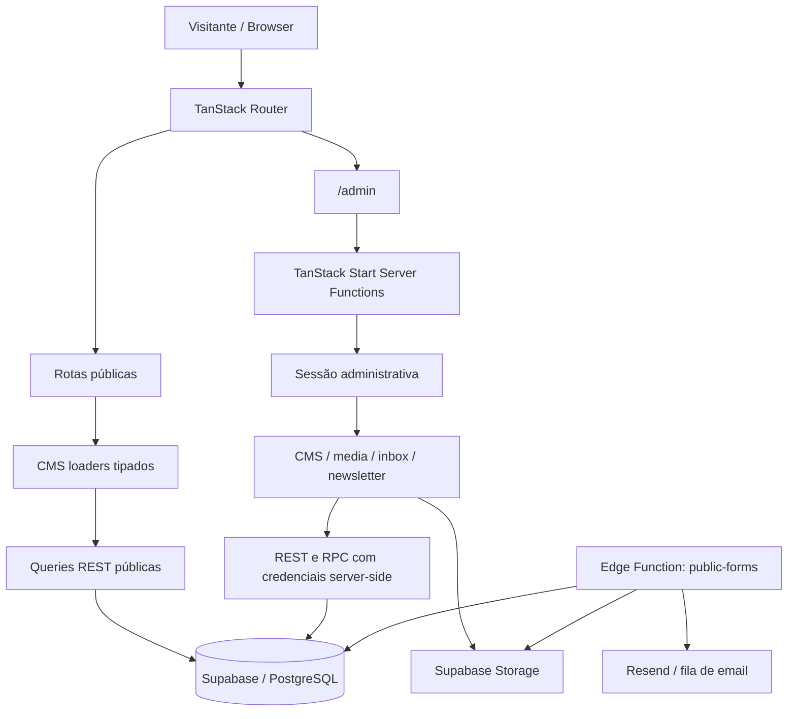

<div align="center">

<pre>
██╗  ██╗  ██╗   ██╗ ████████╗ ███████╗ ████████╗ ███████╗██╗   ██╗
██║ ██╔╝  ██║   ██║ ╚══██╔══╝ ██╔════╝ ╚══██╔══╝ ╚══███╔╝██║   ██║
█████╔╝   ██║   ██║    ██║    █████╗       ██║    █████╔╝ ██║   ██║
██╔═██╗   ██║   ██║    ██║    ██╔══╝       ██║   ███╔╝   ██║   ██║
██║  ██╗  ╚██████╔╝    ██║    ███████╗     ██║  ███████╗ ╚██████╔╝
╚═╝  ╚═╝   ╚═════╝     ╚═╝    ╚══════╝     ╚═╝  ╚══════╝  ╚═════╝
</pre>

### ED MUNDO KUTUZOV / DIGITAL PORTFOLIO

**Art direction. Brand systems. Digital experiences.**

A living portfolio for work that refuses to be ignored.

<br />

[](https://kutuzovportfolio333.lovable.app)
[](https://lovable.dev/projects/866320a4-978d-403b-b184-3e3fd57d0c19)
[](https://github.com/edmundokutuzov333/kutuzovportfolio333/actions)

<br />

`DESIGN` &nbsp; / &nbsp; `ENGINEERING` &nbsp; / &nbsp; `STORY`

</div>

---

> [!NOTE]
> Este README descreve a arquitectura e as funcionalidades encontradas no código do repositório. A existência de uma função no código não garante, por si só, que todas as credenciais externas estejam configuradas ou que a versão mais recente já esteja publicada no domínio público. Os bloqueios conhecidos estão documentados no final.

## 00 / Índice

- [A ideia](#01--a-ideia)
- [Mapa do site](#02--mapa-do-site)
- [O que cada página faz](#03--o-que-cada-página-faz)
- [Conteúdo e universo criativo](#04--conteúdo-e-universo-criativo)
- [Experiência visual](#05--experiência-visual)
- [Admin e CMS](#06--admin-e-cms)
- [Arquitectura](#07--arquitectura)
- [Modelo de conteúdo](#08--modelo-de-conteúdo)
- [Formulários, newsletter e media](#09--formulários-newsletter-e-media)
- [Stack tecnológica](#10--stack-tecnológica)
- [Começar localmente](#11--começar-localmente)
- [Variáveis de ambiente](#12--variáveis-de-ambiente)
- [Importar conteúdo para o CMS](#13--importar-conteúdo-para-o-cms)
- [Qualidade, testes e release](#14--qualidade-testes-e-release)
- [Estrutura do repositório](#15--estrutura-do-repositório)
- [Segurança e limites conhecidos](#16--segurança-e-limites-conhecidos)

---

## 01 / A ideia

**Edmundo Kutuzov** é director de arte a partir de Maputo, Moçambique, com uma prática que cruza direcção criativa, sistemas de identidade, campanhas, design digital, conteúdo e ferramentas de inteligência artificial.

O site foi concebido como uma experiência editorial, não como uma grelha convencional de trabalhos. O ritmo da navegação, a tipografia, o movimento e a apresentação dos projectos fazem parte da narrativa profissional.

```text
                    STRATEGY
                       |
                       v
    BRAND SYSTEMS --> VISUAL LANGUAGE <-- CULTURE
                       |
                       v
                 DIGITAL + PRINT
                       |
                       v
                    MEMORY
```

### A intenção de design

| Princípio | Como se traduz no site |
|---|---|
| **Clarity** | Hierarquia tipográfica forte e conteúdo organizado por intenção. |
| **Rhythm** | Alternância de escala, espaço, movimento e blocos editoriais. |
| **Precision** | Composição cuidada, metadados, texto alternativo e regras de conteúdo tipadas. |
| **Memory** | Identidade escura, contraste controlado e trabalhos apresentados como estudos de caso. |

O projecto combina uma superfície visual imersiva com uma camada de conteúdo que pode ser actualizada através do CMS, sem ter de reconstruir as páginas sempre que um texto, projecto ou cliente muda.

### Acesso rápido

| Recurso | Endereço |
|---|---|
| Site público | [kutuzovportfolio333.lovable.app](https://kutuzovportfolio333.lovable.app) |
| Editor Lovable | [Abrir projecto](https://lovable.dev/projects/866320a4-978d-403b-b184-3e3fd57d0c19) |
| Código-fonte | [GitHub repository](https://github.com/edmundokutuzov333/kutuzovportfolio333) |
| Workflow de CI | [GitHub Actions](https://github.com/edmundokutuzov333/kutuzovportfolio333/actions) |

---

## 02 / Mapa do site

As rotas são geradas pelo **TanStack Router** a partir dos ficheiros em `src/routes/`. `src/routeTree.gen.ts` é um artefacto gerado e não deve ser editado manualmente.

| Rota | Função |
|---|---|
| `/` | Home, manifesto, trabalho em destaque, serviços, métricas, clientes e princípios. |
| `/work` | Índice dos projectos com filtro por disciplina. |
| `/work/:slug` | Estudo de caso dinâmico, com cliente, ano, disciplina, desafio, ideia, resultado e galeria. |
| `/about` | Perfil, percurso profissional, competências, disciplinas e princípios. |
| `/services` | Serviços apresentados em painéis expansíveis com descrição e entregáveis. |
| `/process` | Processo criativo em quatro etapas, apresentado como uma sequência horizontal. |
| `/clients` | Lista de clientes em faixa de movimento e grelha. |
| `/contact` | Formulário de pedido de projecto com várias etapas e anexos opcionais. |
| `/newsletter/confirm?token=…` | Confirmação da subscrição através de um token de utilização única. |
| `/newsletter/unsubscribe?token=…` | Cancelamento de uma subscrição através de um token. |
| `/admin` | Interface privada de gestão editorial. Não pertence à navegação pública. |

As oito rotas de conteúdo são alimentadas pelos loaders em `src/lib/cms/loaders.ts`. As duas rotas de newsletter tratam acções de subscrição e não são páginas editoriais tradicionais.

---

## 03 / O que cada página faz

### `/` / Home

A Home é composta por secções editoriais tipadas. A sua ordem e visibilidade são obtidas do CMS. Os tipos suportados na página inicial incluem:

- **Hero**: headline principal, introdução e apresentação inicial.
- **Manifesto**: posicionamento criativo.
- **Featured work**: selecção de projectos em destaque.
- **Services**: resumo das áreas de trabalho.
- **Metrics**: indicadores profissionais.
- **Clients**: faixa de marcas e ligação para a página completa.
- **Principles**: princípios de trabalho.

A página combina um hero de ecrã inteiro, secções com revelação progressiva, cartões de projecto, métricas, clientes e conteúdo modular.

### `/work` / Projectos

A listagem é baseada em projectos publicados. O filtro é construído a partir das disciplinas presentes nos dados. Cada cartão liga ao estudo de caso correspondente.

### `/work/:slug` / Estudo de caso

Cada projecto publicado tem uma rota dinâmica. O detalhe apresenta:

- Cliente, disciplina, ano e papel.
- Desafio que o trabalho procurou resolver.
- Ideia criativa.
- Resultado.
- Capa e galeria.
- Navegação para o projecto seguinte.
- Metadados SEO específicos do projecto.

O router trata slugs inexistentes e redireccionamentos activos de slugs antigos.

### `/about` / Perfil

A página de perfil reúne biografia, métricas, experiência, competências, disciplinas e princípios.

O conteúdo de referência em `src/lib/content.ts` apresenta um percurso que inclui WEBMASTERS Limitada, SPOT Comunicação, Ikigai Moçambique, Imperial Seguros e Agência Creer. A base de competências inclui Adobe Photoshop, Adobe Illustrator, Adobe Premiere, Adobe After Effects e inteligência artificial.

### `/services` / Serviços

Os serviços são apresentados como painéis expansíveis, com linha de posicionamento, descrição e entregáveis. O conjunto inicial de conteúdo inclui cinco áreas:

1. Visual Identity
2. Art Direction
3. Editorial & Print
4. Digital Design
5. AI Creative Direction

Os dados publicados no CMS são a fonte de verdade em execução; estes nomes descrevem o conteúdo de referência do importador.

### `/process` / Processo

O processo criativo é apresentado em quatro momentos:

`01 Discovery & Immersion` → `02 Strategic Direction` → `03 Design & Craft` → `04 Production & Rollout`

A página usa uma sequência horizontal ligada ao progresso de scroll, com uma linha de progresso correspondente.

### `/clients` / Clientes

A página de clientes inclui uma faixa de logótipos e uma grelha. O conteúdo de referência contém 20 marcas, com suporte para logótipo ou apresentação apenas em texto, descrição alternativa e visibilidade por contexto.

### `/contact` / Contacto

O formulário reúne os dados do pedido de projecto por etapas. O conteúdo do CMS fornece tipos de projecto, opções de orçamento e passos do formulário. O código suporta anexos de imagem sujeitos a validação.

A confirmação de envio só deve aparecer depois de o servidor confirmar a gravação. A notificação por email é tratada separadamente, para que uma falha de email não apague nem invalide um pedido já persistido.

### Newsletter

A subscrição utiliza estado pendente e confirmação através de token. A confirmação e o cancelamento consomem tokens próprios, com validade e utilização controladas no servidor.

---

## 04 / Conteúdo e universo criativo

O ficheiro `src/lib/content.ts` conserva os dados de referência utilizados pelo importador e pelos testes de paridade. Depois da migração, o conteúdo publicado deve ser lido do CMS no Supabase.

### Projectos presentes no conteúdo de referência

| Slug | Projecto | Cliente / contexto | Disciplina |
|---|---|---|---|
| `diga-yes` | Diga YES & Viva o Mundo Online | Webmasters / YES | Campaign Design |
| `jogue-venca-repita` | Jogue, Vença, Repita. | Webmasters | Social Media |
| `datas-que-ligam` | Datas que Ligam | Webmasters / YES | Content Creation |
| `somos-uma` | Somos Uma | Webmasters | Art Direction |

Os quatro casos de estudo do importador incluem desafio, ideia, resultado e galerias. A publicação efectiva continua a depender do estado dos registos no CMS.

### Clientes do conteúdo de referência

Absa · Toyota Moçambique · Nissan Moçambique · Hyundai Moçambique · Galp · TotalEnergies · Vodacom · Ronil Auto Moçambique · Pernod Ricard Moçambique · GIZ · MultiChoice (DStv & GOtv) · KitKat · Flying Fish · Brutal Fruit · Joaquim Chaves Saúde · Ponta Apart Hotel · Hotel Cardoso · EMOSE · Moçambique Companhia de Seguros · PROMAR.

### Disciplinas

O perfil agrupa as áreas de trabalho em três famílias:

- **Core Disciplines**: Art Direction, Brand Identity Systems, Campaign Design, Creative Direction, Visual Hierarchy & Typography.
- **Digital & Motion**: Social-First Content Systems, Motion Design & Key Art, UI/UX Design Systems, AI Creative Direction, Audiovisual Storytelling.
- **Print & Special Projects**: Editorial & Publications, Large-Format OOH, Packaging & Print Prep, Music Video & Single Rollouts, Streetwear Curation.

### O princípio editorial

A informação em `src/lib/content.ts` deve ser entendida como conteúdo de referência e fonte para o importador. Alterar esse ficheiro não equivale a editar directamente o site publicado quando o CMS está activo.

---

## 05 / Experiência visual

A linguagem visual parte de um fundo azul-noite, tipografia expressiva, contraste e grandes áreas de respiro.

### Tipografia

| Família | Papel |
|---|---|
| **Syne** | Títulos, headlines e momentos de maior escala. |
| **Manrope** | Texto de leitura e conteúdo de interface. |
| **JetBrains Mono** | Eyebrows, numeração, metadados e etiquetas técnicas. |

### Tokens centrais

Os valores são definidos em `src/styles.css`, com cores em OKLCH.

```css
:root {
  --background: oklch(0.14 0.015 260);
  --foreground: oklch(0.95 0.01 250);
  --card: oklch(0.18 0.03 262);
  --primary: oklch(0.55 0.21 264);
  --muted-foreground: oklch(0.68 0.03 255);
}
```

### Movimento e componentes visuais

O projecto inclui:

- Cursor personalizado nas páginas públicas em dispositivos com ponteiro preciso.
- Introdução visual e componentes de identidade tridimensional.
- Animações e revelações progressivas construídas com Framer Motion.
- Lenis para a experiência de scroll do site público.
- Faixas de clientes e componentes editoriais de movimento.
- Secção horizontal na página de processo.
- `SafeAssetImage` e slots de imagem para tratar recursos indisponíveis sem quebrar o layout.

O Admin tem um âmbito visual separado: a interface administrativa não deve depender do Shell público, do cursor personalizado ou de efeitos decorativos para funcionar. As alterações ao seu cursor e à sua apresentação devem ser limitadas às rotas administrativas.

---

## 06 / Admin e CMS

O Admin é uma interface de gestão editorial construída sobre a mesma aplicação. O seu código encontra-se em `src/routes/admin.tsx` e `src/components/admin/`.

### Módulos administrativos existentes no código

| Módulo | Responsabilidade |
|---|---|
| Visão geral | Estado do CMS e actividade editorial. |
| Páginas | Títulos, rotas suportadas, idioma, publicação e SEO. |
| Secções | Configuração tipada, visibilidade e ordem das secções. |
| Projectos | Estudos de caso, cliente, conteúdo, capa, galeria, destaque, estado e ordenação. |
| Clientes | Marcas, logótipos, texto alternativo e visibilidade por contexto. |
| Perfil | Biografia, cargo, contactos públicos e redes sociais. |
| Experiência | Percurso profissional e ordem. |
| Métricas | Indicadores profissionais. |
| Competências | Competências e níveis. |
| Disciplinas | Grupos e listas de disciplinas. |
| Princípios | Princípios editoriais. |
| Serviços | Descrição, entregáveis e ordem. |
| Processo | Etapas do processo de trabalho. |
| Definições e SEO | Navegação, rodapé, apresentação, capacidades e opções globais existentes. |
| Histórico | Revisões de conteúdo, snapshots e restauro auditado. |
| Caixa de entrada | Pedidos de contacto, estado, notas internas e anexos privados. |
| Newsletter | Subscritores, consentimento e estado de subscrição. |
| Fila de email | Estado das notificações, falhas e novas tentativas. |
| Biblioteca multimédia | Upload, metadados, referências e remoção controlada de assets. |

O inventário acima descreve os módulos presentes no código, não uma garantia de que todos os fluxos estejam operacionais em qualquer ambiente sem a configuração do backend.

### Escrita editorial

As chamadas de servidor são definidas em:

- `src/lib/admin-auth.functions.ts`
- `src/lib/admin-cms.functions.ts`
- `src/lib/admin-media.functions.ts`

Os handlers de CMS usam validação com Zod e os módulos server-only estão em `src/lib/server/`.

As operações editoriais são efectuadas pelas funções SQL administrativas, incluindo mutações de conteúdo, reordenação e actualização de pedidos de contacto. O código contempla controlo optimista de conflitos através de `updated_at`, histórico e revisão publicada.

### Rota e preview

`src/routes/admin.tsx` define a rota `/admin`; o router gerado encontra-se em `src/routeTree.gen.ts`.

A existência da rota no código não prova automaticamente que o selector de páginas do preview da Lovable a apresenta. Depois de alterações ao router, confirma a geração da árvore, a sincronização com a Lovable e a descoberta da rota no próprio editor.

---

## 07 / Arquitectura

### Visão geral



### Camadas da aplicação

**Apresentação**
- `src/routes/`: rotas file-based.
- `src/components/`: shell público, componentes editoriais, identidade visual e componentes administrativos.
- `src/styles.css`: tokens, estilos globais e regras de apresentação.
- `src/components/ui/`: componentes de interface reutilizáveis baseados em Radix e Tailwind.

**Conteúdo público**
- `src/lib/cms/loaders.ts`: compõe os dados necessários a cada página.
- `src/lib/cms/queries.ts`: consultas de páginas e conteúdo publicado.
- `src/lib/cms/types.ts`: schemas Zod, tipos e validação do domínio de conteúdo.
- `src/lib/cms/public-client.ts`: cliente REST público, configuração e validação de origem.
- `src/lib/seo.ts`: metadados, Open Graph, Twitter cards e URLs canónicas.

**Admin e operações**
- `src/lib/admin-cms.schema.ts`: entidades, acções e validação do payload editorial.
- `src/lib/server/admin-auth.server.ts`: autenticação e sessão no servidor.
- `src/lib/server/admin-cms.server.ts`: operações CMS server-side.
- `src/lib/server/admin-media.server.ts`: media, armazenamento, anexos e reenvio de email.
- `src/components/admin/Phase4Modules.tsx`: módulos operacionais adicionais do Admin.

**Backend**
- Supabase PostgreSQL através de REST e funções RPC.
- Supabase Storage para assets públicos e anexos privados.
- Supabase Edge Function `public-forms` para contacto, newsletter e acções de token.
- Resend para envio de email transaccional, quando configurado.

### Fluxo de publicação

```text
CONTENT SEED / ADMIN
        |
        v
  Typed validation (Zod)
        |
        v
 Server Function
        |
        v
 Supabase RPC / transaction
        |
        +----> content revision + audit
        |
        v
 publication revision
        |
        v
 public loaders -> rendered route
```

As rotas públicas pedem conteúdo publicado, validam os dados recebidos e utilizam `cache: "no-store"` nas queries REST. A Home aplica a ordem e a visibilidade das secções. O Shell público consulta a revisão publicada e invalida as rotas quando detecta uma alteração.

---

## 08 / Modelo de conteúdo

O domínio de conteúdo está definido em `src/lib/cms/types.ts`, com schemas tipados para normalizar as respostas do CMS.

| Entidade | Função |
|---|---|
| `pages` | Rotas de conteúdo, títulos, idioma, estado e SEO. |
| `page_sections` | Secções, configuração tipada, ordem e visibilidade. |
| `profile_content` | Perfil e dados públicos. |
| `projects` | Estudos de caso, capa, galeria e estado editorial. |
| `clients` | Clientes, logos, ordem e visibilidade. |
| `services` | Serviços e entregáveis. |
| `process_steps` | Etapas do processo. |
| `metrics` | Indicadores apresentados no perfil e na Home. |
| `experience_items` | Experiência profissional. |
| `skills` | Competências. |
| `disciplines` | Grupos de disciplinas. |
| `principles` | Princípios editoriais. |
| `site_settings` | Navegação, rodapé e outras definições públicas. |
| `site_publication_state` | Revisão publicada utilizada para detectar actualizações. |
| `slug_redirects` | Redireccionamentos para slugs de projecto antigos. |
| `content_revisions` | Histórico, snapshots e restauro. |
| `contact_submissions` | Pedidos de contacto recebidos. |
| `newsletter_subscribers` | Estado e consentimento da subscrição. |
| `email_outbox` | Fila persistente e estado operacional das notificações. |
| `media_assets` | Metadados de assets registados. |
| `asset_migration_inventory` | Inventário e estado de migração dos recursos antigos. |

O importador usa `src/lib/content.ts` como conteúdo de referência. `scripts/import-static-content.ts` insere registos em falta e foi desenhado para ser idempotente, sem substituir valores posteriormente editados no Admin.

---

## 09 / Formulários, newsletter e media

### Contacto

A Edge Function `supabase/functions/public-forms/` processa pedidos enviados através de `src/lib/public-forms.ts`.

Características implementadas no código:

- Validação no servidor e controlo de origem.
- Limitação persistente de pedidos.
- Registo do contacto antes da confirmação ao visitante.
- Suporte para até cinco anexos de imagem.
- Limite de 8 MB por ficheiro e 40 MB no conjunto.
- Validação dos tipos PNG, JPEG e WEBP.
- Armazenamento privado dos anexos.
- Resposta com referência real da submissão depois da confirmação da escrita.

### Newsletter

- Subscrição inicialmente pendente.
- Consentimento com versão registada.
- Tokens aleatórios de uso único, armazenados através de hashes.
- Confirmação e cancelamento por rotas próprias.
- Fila persistente para as notificações de email.
- Rejeição de links inválidos, expirados ou já consumidos.

Sem as credenciais do fornecedor de email, a aplicação não deve simular entrega. A fila conserva os estados de falha que podem ser inspeccionados no Admin.

### Media

O código utiliza os buckets:

- `portfolio-public-assets`: recursos públicos do portfólio.
- `contact-private-attachments`: anexos privados de pedidos de contacto.

O upload administrativo aceita PNG, JPG/JPEG e WEBP até 15 MB por imagem. O servidor inspecciona os bytes, valida o conteúdo e as dimensões, calcula SHA-256 e regista metadados. Antes de apagar um asset, procura referências no conteúdo e bloqueia a remoção se ainda estiver em uso.

Os links assinados dos anexos privados são temporários e o servidor verifica a associação entre o ficheiro e a submissão antes de os gerar.

---

## 10 / Stack tecnológica

| Camada | Tecnologia |
|---|---|
| Linguagem | TypeScript, com configuração strict |
| UI | React 19 |
| Framework web | TanStack Start |
| Routing | TanStack Router, rotas baseadas em ficheiros |
| Data fetching | TanStack Query |
| Build / dev server | Vite 8 + integração de configuração Lovable + Nitro |
| CSS | Tailwind CSS 4 e tokens CSS próprios |
| Motion | Framer Motion |
| Scroll | Lenis |
| 3D | Three.js, React Three Fiber e Drei |
| Componentes acessíveis | Radix UI |
| Formulários e validação | React Hook Form, resolvers e Zod |
| Iconografia | Lucide React |
| Notificações | Sonner |
| Backend | Supabase PostgreSQL, REST, RPC, Storage e Edge Functions |
| Email | Resend, através da fila transaccional |
| Testes unitários | Vitest + Testing Library + jsdom |
| Testes de browser | Playwright |
| Runtime local | Bun 1.3.10 |

### Instalação reproduzível

O projecto mantém `bun.lock` e `.bun-version`. Evita misturar lockfiles ou actualizar dependências sem executar todas as verificações de release.

---

## 11 / Começar localmente

### Requisitos

- Git
- Bun `1.3.10`
- Node.js para os comandos e testes que o utilizam
- Acesso ao projecto Supabase para funcionalidades CMS e Admin completas

### Setup

```bash
git clone https://github.com/edmundokutuzov333/kutuzovportfolio333.git
cd kutuzovportfolio333

bun install --frozen-lockfile
bun run dev
```

O servidor de desenvolvimento utiliza a configuração incluída em `@lovable.dev/vite-tanstack-config`. Consulta os logs do terminal se o servidor não iniciar ou se a descoberta de rotas não estiver actualizada.

### Build local

```bash
bun run typecheck
bun run lint
bun run test
bun run build
```

Para abrir localmente a versão compilada:

```bash
bun run preview
```

### Contratos públicos

Este comando consulta a API pública real e não deve criar nem alterar registos de produção:

```bash
bun run test:contracts
```

### Testes de browser

O workflow de CI instala uma versão fixa do Playwright e o Chromium. Para reproduzir esse caminho localmente:

```bash
npm install --prefix .e2e --no-save --no-package-lock --no-audit --no-fund @playwright/test@1.64.1
./.e2e/node_modules/.bin/playwright install chromium
./.e2e/node_modules/.bin/playwright test --config .e2e/playwright.config.mjs
```

O conjunto e o comando exacto encontram-se em `.e2e/`.

---

## 12 / Variáveis de ambiente

Copia `.env.example` apenas para desenvolvimento local e configura os valores no gestor de segredos do ambiente correspondente. Nunca commits tokens, passwords ou chaves privilegiadas.

| Variável | Âmbito | Utilização |
|---|---|---|
| `VITE_SUPABASE_URL` | Pública | URL utilizada pelo cliente de conteúdo no browser; existe fallback de configuração no código. |
| `VITE_SUPABASE_PUBLISHABLE_KEY` | Pública | Chave publicável Supabase. |
| `VITE_SUPABASE_ANON_KEY` | Pública | Alternativa compatível para a chave pública. |
| `VITE_PUBLIC_SITE_URL` | Pública | Origem HTTPS utilizada para URLs canónicas e metadados SEO. |
| `SUPABASE_URL` | Servidor | URL para as operações privilegiadas do CMS, Admin e scripts. |
| `SUPABASE_SERVICE_ROLE_KEY` | **Só servidor** | Acesso privilegiado às operações editoriais, armazenamento e scripts. Nunca expor ao browser. |
| `PUBLIC_SITE_URL` | Servidor / scripts | Origem canónica para validações do CMS, importação e inventário de assets. |
| `ADMIN_SESSION_SECRET` | Servidor, recomendado | Material dedicado para assinatura da sessão administrativa, quando configurado. |
| `RESEND_API_KEY` | Edge Function | Credencial de envio de email transaccional. |
| `MAIL_FROM` | Edge Function | Remetente usado pelo fornecedor de email. |
| `ADMIN_EMAIL` | Edge Function, opcional | Endereço de notificação administrativa; sem override, o código pode usar o email público publicado do perfil. |

**Nota sobre o Admin:** as credenciais Supabase são necessárias para as operações CMS com dados reais, mas a criação da sessão por PIN foi separada dessa dependência. Uma entrada bem-sucedida não prova, por si só, que a base de dados, o armazenamento ou o email estejam configurados.

As chaves `VITE_*` fazem parte da configuração pública do browser. Nunca coloques uma chave de serviço, segredo HMAC ou credencial privada numa variável `VITE_*`.

---

## 13 / Importar conteúdo para o CMS

O importador inicial lê os dados de referência de `src/lib/content.ts` e os manifestos de assets. A operação é idempotente: insere apenas registos em falta e não substitui as alterações editoriais já guardadas.

Exemplo:

```bash
SUPABASE_URL="https://your-project-ref.supabase.co" \
SUPABASE_SERVICE_ROLE_KEY="configure-privately" \
PUBLIC_SITE_URL="https://kutuzovportfolio333.lovable.app" \
bun run import:cms
```

O comando gera `reports/cms-import-reconciliation.json`. O relatório permite comparar o conteúdo esperado com o que foi inserido.

**Antes de executar:** confirma o projecto Supabase de destino, a configuração das credenciais, o estado das migrations e o relatório de reconciliação. O comando não deve ser tratado como uma forma de substituir conteúdo editorial existente.

### Inventário de assets

```bash
bun run assets:inventory
```

O relatório é escrito em `reports/assets-inventory.json`. A ferramenta verifica os manifestos `*.asset.json`, a validade dos seus campos e a presença de binários locais. Um manifesto válido não significa que o binário de origem esteja disponível ou que a imagem esteja acessível no site.

---

## 14 / Qualidade, testes e release

O workflow principal encontra-se em `.github/workflows/ci.yml`.

### Gates principais

1. Secret scanning com Gitleaks.
2. Instalação com `bun.lock` congelado.
3. Auditoria de dependências com bloqueio para severidade alta/crítica.
4. TypeScript.
5. ESLint.
6. Testes unitários.
7. Contratos de leitura pública e permissões anónimas.
8. Build de produção.
9. Inventário de assets.
10. Playwright para rotas, comportamento público, formulários e gate do Admin.
11. Regeneração da árvore de rotas TanStack após as verificações necessárias.

### Comandos de referência

| Script | Finalidade |
|---|---|
| `bun run dev` | Desenvolvimento local. |
| `bun run build` | Build de produção. |
| `bun run build:dev` | Build em modo de desenvolvimento. |
| `bun run preview` | Servir a build localmente para revisão. |
| `bun run typecheck` | Build de validação e TypeScript sem emissão. |
| `bun run lint` | ESLint. |
| `bun run test` | Testes unitários Vitest. |
| `bun run test:watch` | Vitest em modo watch. |
| `bun run test:contracts` | Contratos de acesso público e permissões. |
| `bun run test:e2e` | Testes de browser Playwright. |
| `bun run assets:inventory` | Inventário dos manifestos de assets. |
| `bun run import:cms` | Importação inicial idempotente do conteúdo. |
| `bun run format` | Formatação Prettier. |

### Publicação

A CI valida o código e gera evidência. A publicação do site é uma operação separada na Lovable. Um SHA verde no GitHub não é, por si só, prova de que o domínio público serve essa versão.

Depois de publicar:

- confirma o SHA sincronizado no editor;
- abre as rotas públicas e `/admin` no preview;
- testa contacto e newsletter com configurações controladas;
- confirma que os assets carregam;
- verifica a versão efectivamente servida no domínio público.

---

## 15 / Estrutura do repositório

```text
.
├── .e2e/
│   ├── playwright.config.mjs
│   └── tests/
├── .github/
│   └── workflows/
│       └── ci.yml
├── docs/
│   ├── admin-phase-1-baseline.md
│   ├── admin-phase-3.md
│   ├── cms-phase-2-reconciliation.md
│   ├── phase-4-operations.md
│   └── phase-5-certification.md
├── public/
│   ├── favicon.png
│   └── robots.txt
├── scripts/
│   ├── import-static-content.ts
│   ├── inventory-assets.mjs
│   └── verify-public-contracts.ts
├── src/
│   ├── assets/
│   │   ├── logos/
│   │   └── works/
│   ├── components/
│   │   ├── admin/
│   │   ├── ui/
│   │   ├── Clients.tsx
│   │   ├── Intro.tsx
│   │   ├── Shell.tsx
│   │   └── ...
│   ├── lib/
│   │   ├── cms/
│   │   ├── server/
│   │   ├── admin-auth.functions.ts
│   │   ├── admin-cms.functions.ts
│   │   ├── admin-media.functions.ts
│   │   ├── content.ts
│   │   └── seo.ts
│   ├── routes/
│   │   ├── __root.tsx
│   │   ├── index.tsx
│   │   ├── about.tsx
│   │   ├── admin.tsx
│   │   ├── clients.tsx
│   │   ├── contact.tsx
│   │   ├── process.tsx
│   │   ├── services.tsx
│   │   ├── work.index.tsx
│   │   ├── work.$slug.tsx
│   │   └── newsletter.*
│   ├── routeTree.gen.ts
│   ├── router.tsx
│   └── styles.css
├── supabase/
│   ├── functions/
│   │   └── public-forms/
│   ├── migrations/
│   └── config.toml
├── reports/
├── package.json
├── bun.lock
├── vite.config.ts
└── README.md
```

### Ficheiros-chave

| Ficheiro | Responsabilidade |
|---|---|
| `src/routes/__root.tsx` | Layout raiz, providers e separação do Shell público/Admin. |
| `src/router.tsx` | Criação do router e contexto de query. |
| `src/styles.css` | Tokens, tipografia e estilos globais. |
| `src/lib/content.ts` | Conteúdo de referência usado pelo importador. |
| `src/lib/cms/types.ts` | Schemas e tipos do CMS. |
| `src/lib/cms/loaders.ts` | Carregamento de conteúdo por página. |
| `src/lib/cms/queries.ts` | Consultas públicas ao Supabase. |
| `src/lib/server/` | Operações de autenticação, CMS e media exclusivas do servidor. |
| `supabase/migrations/` | Evolução versionada da base de dados e permissões. |
| `.github/workflows/ci.yml` | Quality gates, testes, inventário e sincronização da árvore de rotas. |

---

## 16 / Segurança e limites conhecidos

Este projecto inclui políticas RLS, funções administrativas server-side, validação de payloads, limitações de pedidos, controlo de conflitos, auditoria e regras distintas para media públicos e anexos privados. Estas protecções têm de permanecer activas quando a aplicação evolui.

### Segredos

- Nunca enviar `SUPABASE_SERVICE_ROLE_KEY` ao browser.
- Não colocar segredos em código público, no README ou em `VITE_*`.
- Não registar tokens, conteúdo sensível de formulários ou credenciais nos logs.
- Manter as chaves e configurações nos gestores de segredos apropriados.
- Confirmar as permissões SQL/RLS depois de qualquer alteração ao CMS.

### PIN administrativo

O gate actual por PIN é uma conveniência de acesso, não um mecanismo de autenticação forte. Um código curto e fixo não protege dados sensíveis contra alguém que o conheça ou consiga inferir a validação no código público. Antes de usar o Admin para dados sensíveis, a autenticação deve ser reforçada com um segredo de servidor não versionado ou outro mecanismo apropriado, mantendo o princípio de não expor credenciais privilegiadas.

### Assets ainda por reconciliar

A documentação de migração regista **41 manifestos de assets** cujos binários originais ainda não foram recuperados e verificados. Os caminhos existentes foram preservados, sem os substituir por referências não verificadas. O inventário deve ser tratado como metadados de origem, não como prova de que todos os ficheiros estão acessíveis.

### Email transaccional

O envio real depende de `RESEND_API_KEY` e `MAIL_FROM` no ambiente da Edge Function. Quando o fornecedor não está configurado ou recusa o envio, a fila regista a falha e permite investigação/repetição. Não deve ser reportado sucesso de entrega sem confirmação do fornecedor.

### Preview e domínio publicado

A árvore de rotas gerada e o domínio publicado são verificações distintas. A rota `/admin` está definida na aplicação, mas a sua presença no selector visual do preview da Lovable tem de ser confirmada no próprio editor. Do mesmo modo, a sincronização de um commit não substitui o smoke test da versão publicada.

### Backup e staging

A documentação das fases regista que um ambiente de staging independente sem custo e uma cópia de segurança de fornecedor verificada não foram confirmados. Não declares esses controlos como concluídos sem evidência.

---

<div align="center">

```text
KUTUZOVPORTFOLIO333
────────────────────────────────────────────
A portfolio is not an archive.
It is a point of view, made navigable.
────────────────────────────────────────────
```

**Built for Edmundo Kutuzov.**

[Website](https://kutuzovportfolio333.lovable.app) · [Lovable](https://lovable.dev/projects/866320a4-978d-403b-b184-3e3fd57d0c19) · [Source](https://github.com/edmundokutuzov333/kutuzovportfolio333)

<sub>Documentação baseada na implementação do repositório. Actualiza este ficheiro quando as rotas, os módulos CMS, o modelo de dados ou as dependências operacionais mudarem.</sub>

</div>
